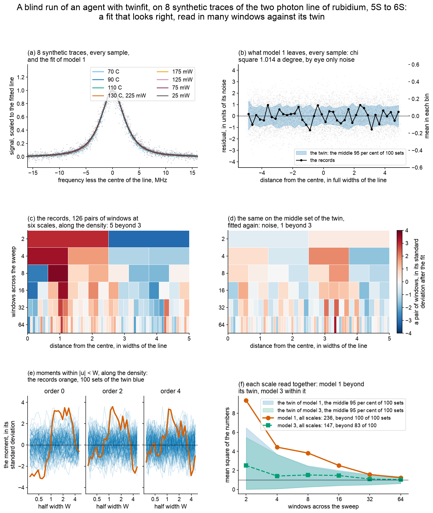
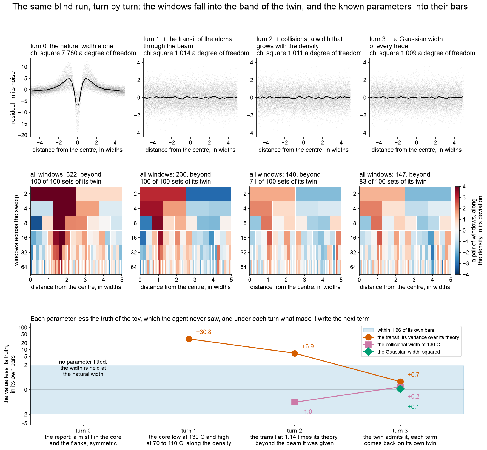

# twinfit

Find what your model is missing. twinfit fits one model to several measured curves, reads the residuals against synthetic curves drawn from that fit, and tells you where the model misses, what the miss looks like and what it does to the parameters the curves share.

Five minutes: the clock below. An hour: `twinfit/TUTORIAL.md`. Other fields: `twinfit/EXAMPLES.md`. For an agent: `twinfit/agent/AGENT.md`.

> Section 1 of `twinfit/TUTORIAL.md` defines the terms used on this page.

## Purpose

A model can pass the usual test of fit and still lack an effect, a broadening, a background, a drift. The missing effect biases the fitted parameters while the reduced chi square stays near one.

twinfit starts from the data. It computes statistics of the residuals and compares each with the same statistic on synthetic curves drawn from the fitted model, its twin. Where the residuals stand out it reports what it can read of them: the region of the curve, the structure (a trend, a periodic pattern, a noise off its law), the size, the setting of the experiment along which the excess varies, and how far each shared parameter would move if the excess were a real term. It names no physical term: that is yours. A structure its statistics cannot read still shows as an excess.

In the terms of statistics, the twin is a parametric bootstrap from the fitted model (Efron and Tibshirani 1993), and the report as a whole is a test of the specification by weighted moments of the residuals, of the family of the conditional moment tests (Bierens 1990), calibrated by the parametric bootstrap. A statistic stands out where it passes the 95th percentile, over the bootstrap sets, of the largest standardized statistic of each set over every answer of the report, a familywise critical value of the maximum statistic with the whole report as its family (Westfall and Young 1993). A term is kept where, among its conditions, the Bayesian information criterion (Schwarz 1978) falls by more than 2, positive evidence on the scale of Kass and Raftery (1995). Section 1 of `twinfit/TUTORIAL.md` sets the words of these pages that the literature of statistics names otherwise beside their names there, with the references.

Version 0.1.1 was measured on synthetic curves of the author's own experiment, the real case of `python -m twinfit guide rubidium`, and on eleven synthetic projects of other fields. 0.1.2 is 0.1.1 with its pages and tutorials written again and the help of one command repaired. The counts hash the code without its docstrings and stand, but the count of the eleven projects, which hashes every program of the package but `version.py`, is made again on the same seeds at the stamp of 0.1.2, since the program that writes the tutorials changed, and the matrix table, which no criterion reads, keeps a digest that its check refuses, as `twinfit/CONTINUING.md` says. The shares are below and in full in `docs/VALIDATION.md` of the repository.

## Continuing this work

Source and the bench the shares were counted on, with the checks of its counts: https://github.com/MichelangeloDondi/twinfit. `twinfit/CONTINUING.md`, beside the file that the last line of `python -m twinfit guide readme` names, is for a researcher who takes the work over. To cite twinfit: M. Dondi, twinfit, the version that `python -m twinfit --version` prints, https://github.com/MichelangeloDondi/twinfit. It is under the MIT licence, `twinfit/LICENSE`.

## Method

1. One model is fitted to all the curves at once, with parameters shared by the curves and parameters of each curve.
2. The residuals are read through families of statistics: generalized moments under several kernels, sums over windows along the abscissa and along the value, and the same on transformations of the value. Each is compared with its value on the twin, synthetic curves drawn from the fit with the noise law of the records, fitted and read the same way.
3. The report keeps what the fitted parameters cannot produce and says where the model misses and along which setting.
4. You, or an agent in your place, write the effect as a term. twinfit keeps it if its fit ends inside its bounds, the Bayesian information criterion falls by more than 2, and the twin admits the new model. Each turn ends with three proposals for the model and three for the experiment.



*A blind run of an agent on eight synthetic curves of the line of `RUBIDIUM.md`. (a, b) Turn 2, model 1, chi square 1.014 a degree of freedom. (c, d) The residuals summed in pairs of windows at six scales along the density. On a set of the twin the sums are noise about zero. (e, f) Model 1 lies beyond all 100 sets of its twin, model 3 within them.*

## Output

The best model and, for each parameter, its uncertainty in five parts kept separate: three that are its uncertainty, the standard error of the fit, the uncertainty carried from theory and the spread over the models the records cannot tell apart, and two that check the first, its coverage on the twin and its bias there, with no bar where the records fix only a combination.



*The same run, turn by turn. With model 1 the size of its term reads 31 bars too large at a chi square of 1.014. A width that varies along the density takes it to 6.9 bars, a width of each curve to 0.7, within its bars. The run found three of the four terms and missed the smallest.*

## Shares measured on synthetic projects

Each share with its standard error. Three stand outside their thresholds, read against `docs/VALIDATION.md`, the full table, which `docs/validation.py` writes from the tables.

- The place of a hidden term, put first or tied for first: 0.791 ± 0.010 of 1600 draws, on a model of five terms fitted with one of four terms left out at its size. At half that size: 0.1244 ± 0.0083 of 1600.
- The setting along which the term varies, named first: 0.583 ± 0.017 of 800 draws, below its threshold of 0.60.
- The place of a width that grows steeply along a setting: 0.470 ± 0.025 of 400 draws, below its threshold of 0.60.
- False alarms on a model with nothing missing, at the default of 30 sets against the draw's own twin: 0.188 ± 0.025 of 250 draws, above its ceiling of 0.12, and 0.0760 ± 0.0059 of 2000 against the twin of the case, five right models.
- The bar of the width that grows steeply along a setting holding the truth under the noise law read from the author's recorded traces: 0.744 ± 0.022 of 399 draws, within its band of 0.62 to 0.75.
- Eleven projects of other fields, pooled over every question: 0.761 ± 0.020 of 440 draws, the place of the misfit alone 0.594 ± 0.039 of 160, with the key's own answer put first on 0 of 40 draws for the projects pedestal, returns.

An effect that a parameter of the model can absorb leaves nothing in the residuals, and a model that its twin admits is not thereby complete.

## By hand or with an agent

`twinfit/TUTORIAL.md` takes you from a first project to the best model, `twinfit/agent/TUTORIAL.md` does the same for an agent, and `twinfit/agent/AGENT.md` lets an agent take your place. `twinfit/EXAMPLES.md` holds eleven projects of other fields.

## Requirements and installation

Python 3.12 or later, numpy 2.5 or later, scipy 1.16 or later, and matplotlib for the visual log. The bench of the repository reads its tables on the Python that made them, 3.14: on another version its checks but the gallery's, whose digest hashes bytes, report the tables as made from other files, and a count made again keeps its own rows. On Windows the loop cannot start, because it locks its files with `fcntl`.

```
pip install twinfit
```

`pip install "twinfit[log]"` adds matplotlib. From a copy of the source, `pip install /path/to/the/source`.

pip replaces older versions of numpy and scipy, so use a virtual environment of its own.

On a computer with no Python and no administrator password, `uv` installs everything in your own folders:

```
mkdir -p uv && curl -fsSL https://github.com/astral-sh/uv/releases/latest/download/uv-aarch64-apple-darwin.tar.gz | tar -xz -C uv --strip-components=1
```

On an x86_64 Linux machine the archive is `uv-x86_64-unknown-linux-gnu.tar.gz`, on an arm64 Linux one `uv-aarch64-unknown-linux-gnu.tar.gz`, in the same line.

```
uv/uv python install 3.14
uv/uv venv --python 3.14 venv
uv/uv pip install --python venv/bin/python "twinfit[log]"
```

On another machine, use the uv download for that machine. `UV_PYTHON_INSTALL_DIR`, `UV_CACHE_DIR` and `MPLCONFIGDIR` move the caches of uv and matplotlib out of your home folder when it cannot be written. uv also tries to link its Python under `~/.local/bin` and warns when it cannot. The install works regardless. Then `source venv/bin/activate`, and start at the second line of the five minutes.

## Five minutes: an atomic clock at five probe powers

```
pip install twinfit
python -m twinfit example clock clock
python -m twinfit loop clock
```

The second line writes a project into `clock`: five resonances of a clock transition against the detuning of the probe, at 2 to 10 uW, with a first model of one Lorentzian line of one width and one centre. The powers were read by a photodiode calibrated within 2 per cent, which `clock/description.toml` holds as an ansatz under `power scale`. The truth of the project is in the gallery, `python -m twinfit guide examples`.

The loop fits the five curves at once, reads their residuals against 30 synthetic sets drawn from the fit, and writes `clock/loop/model_0.md`. Its section "Where to search" gives the first answer to each question. The largest excess that names a part of the curves is here the question `changes along`:

```
| changes along | which part of the residuals changes from curve to curve along a setting, read on the residuals themselves | the asymmetry along power | 18388.1 |
```

The report names no term. The physics does: an asymmetry that grows with the power of the probe is a centre that moves with the power, a light shift, which the first model lacks. Write it into `clock/model.py`. The centre at a power P becomes the clock frequency plus the light shift times P:

```python
"""A model of one's own: the centre of the line moves with the power of the probe, the light shift, from the frequency of
the clock at no power, which the model then measures."""
import numpy as np

SHARED = ("width", "clock frequency", "light shift")      # the full width, in Hz, the centre at no power less the nominal frequency, in Hz, and its shift, in Hz for each microwatt
OWN = ("height", "background")                           # of each record
START_SHARED = [1.0, 0.0, 0.0]
BOUNDS_SHARED = ([0.05, -3.0, -1.0], [10.0, 3.0, 1.0])
HELD = {"power scale": 1.0}                              # the powers read times this, calibrated within 2 per cent, which description.toml holds
NAME = "one Lorentzian line whose centre moves with the power"
EQUATION = r"$\frac{h}{1 + (2\,(x - \nu_0 - \delta\,P)/w)^2} + b$"          # the model in LaTeX, which the visual log typesets
LETTERS = {"h": "the height", r"\nu_0": "the clock frequency", r"\delta": "the light shift for each microwatt", "P": "the power", "w": "the width", "b": "the background"}          # each letter of EQUATION, which the visual log writes under it


def model(x, shared, own, design):
    centre = shared[1] + shared[2] * design["power"] * HELD["power scale"]
    return own[0] / (1.0 + (2.0 * (x - centre) / shared[0]) ** 2) + own[1]


def start_own(record):
    base = float(np.median(record.y))
    return [float(record.y.max() - base), base]
```

Run `python -m twinfit loop clock` again. The report finds nothing beyond the twin, and `clock/loop/best.md` reports:

```
- clock frequency: 0.12000 ± 0.00038 of the fit
- light shift: 0.025051 ± 0.000058 of the fit ± 0.00050 of theory
```

The uncertainty from theory is the 2 per cent of the calibration, carried through the fit to the light shift and not to the clock frequency. Compare both with the truth in the gallery.

On the first model that `example clock` writes, whose centre is a shared parameter, a term file `clock/terms/01.py` with `term = mechanisms.along("centre", "power")` finds the same light shift, as the line of the centre along the power that `best.md` derives from the size of the term, and the same clock frequency at power 0 to the digit, but it reads no calibration, so its bar carries no form and the held values move nothing. Where the physics gives the law, write it in `model.py`.

Each run takes between ten seconds and a minute on a laptop. The loop writes `clock/loop/` again at each run, so copy it to keep a report. `best.md` may ask for `--sets 500` before a value is quoted. `python -m twinfit guide tutorial` prints the tutorial and `python -m twinfit guide examples` the gallery.

`python -m twinfit guide rubidium` shows a real case: recorded traces of the two photon line of rubidium, as plots, with what the package reads on them.

## A project from measured curves

`python -m twinfit init DIR` writes the starting files of a project: `description.toml`, a first `model.py`, an empty list of terms `list_of_terms.py`, and, for an agent, a page of its instructions and a skill. Each curve is one comma-separated file whose first line names its columns, without a comment line or a byte order mark. The noise of the samples is given one of five ways: one value, a column of each file, read from neighbouring samples, read from what the first model leaves, or a law of your own in `model.py`. Section 9 of the tutorial writes such a project in full.

## Commands

```
python -m twinfit example rubidium DIR  writes into DIR the synthetic traces of the real case of `guide rubidium`: eight
                                            traces of the model of five terms whose values follow their joint fit, each with
                                            the height and the noise of its recorded trace, their description and a first
                                            model of one Lorentzian line
python -m twinfit example NAME DIR [--noise L] [--kind K]
                                       writes a worked project into DIR: chromatography or nmr, or an example of twinfit/EXAMPLES.md.
                                       An example of the gallery alone takes the two options: its noise L times its own, 0 for none drawn, and its kind K, white or correlated, or counts for the examples of a counter alone
python -m twinfit init DIR             writes the starting files of a project into DIR
python -m twinfit loop DIR [--n N] [--sets S] [--max-seconds T] [--workers W] [--dictionary]
                                       fits, reads and reports each model of the project in DIR, and fits the terms written in DIR/terms,
                                       up to N term files, 10 by default, each twin on S synthetic sets, 30 by default and 30 at least.
                                       With T, a run past T seconds of the clock stops at the end of its step and is refused, and the
                                       last whole run stays in DIR/loop. DIR/loop.reuse keeps each costly step, so the next run reads
                                       back what the files, records and fit have not changed, and a stopped run goes on where it stopped. With W, the twins of each model's proposals run side by side
                                       on W cores, every core by default, with the same numbers
                                       With --dictionary, the package's own list of generic terms is set against the residuals beside
                                       your list, list_of_terms.py: asked by you alone, since the package is for the term nobody suspects
python -m twinfit terms                lists the terms of its table, the name that best.md gives each, and the form of a term file. Its first table gives no paragraph for `exponential_width()`, which a term file can name and which runs: docs/ROADMAP.md, section 4, is the repair of that table
python -m twinfit card                 how to write a term file, of the package or of your own, in one page
python -m twinfit log DIR              draws the visual log of the last run in DIR
python -m twinfit wait DIR [--timeout S]  waits up to S seconds for the loop that runs in DIR, 540 by default, and prints its last page for an agent
python -m twinfit literature DIR       the brief of the search of the literature that the description asks, for an agent to run
python -m twinfit scan DIR TERM X...   fits a term whose distance, stretch, period or power is chosen, at each value X
python -m twinfit matrix DIR           what every family reads on the model of DIR, and which statistic sees which law of the noise
python -m twinfit counts DIR [--floor F] writes a copy of DIR whose curves carry the noise of a counter, from the fitted values of the best model
python -m twinfit thin DIR N           writes up to three copies of DIR beside it, each keeping one sample in every N, for a noise correlated over N samples
python -m twinfit guide                prints the protocol for an agent that drives the package
python -m twinfit guide manual         prints the older manual path, for a model that one file model.py cannot hold
python -m twinfit guide examples       prints the gallery, twinfit/EXAMPLES.md: projects of other fields with their truth
python -m twinfit guide tutorial       prints the tutorial, twinfit/TUTORIAL.md, and `guide readme` this page, each with its path
python -m twinfit guide agent-tutorial prints the tutorial for an agent, twinfit/agent/TUTORIAL.md, with its path
python -m twinfit --version            prints the number of the package
python -m twinfit guide rubidium       prints a real case, recorded traces of a line of rubidium as plots, with the folder of its figures
python -m twinfit walk [HIDDEN] [DIR]  walks one rung of that older manual path, on synthetic records with a hidden term
python -m twinfit.tutorial --check     runs every command of the tutorial again, with matplotlib, and says whether an output changed
```

The tutorial, from a first project to the best model, is `twinfit/TUTORIAL.md`. Its first project is written by `python -m twinfit example nmr my_nmr`.
