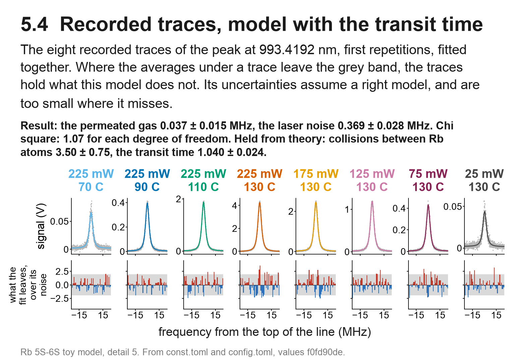
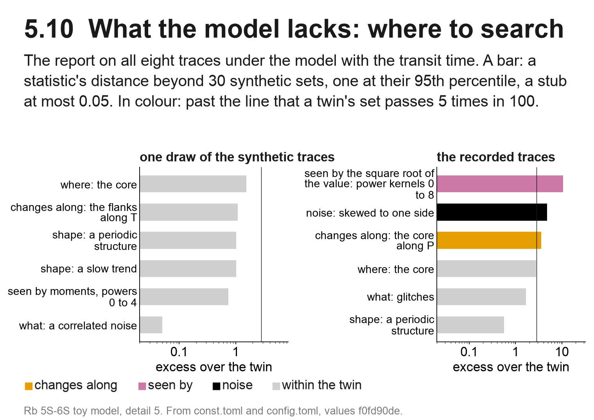
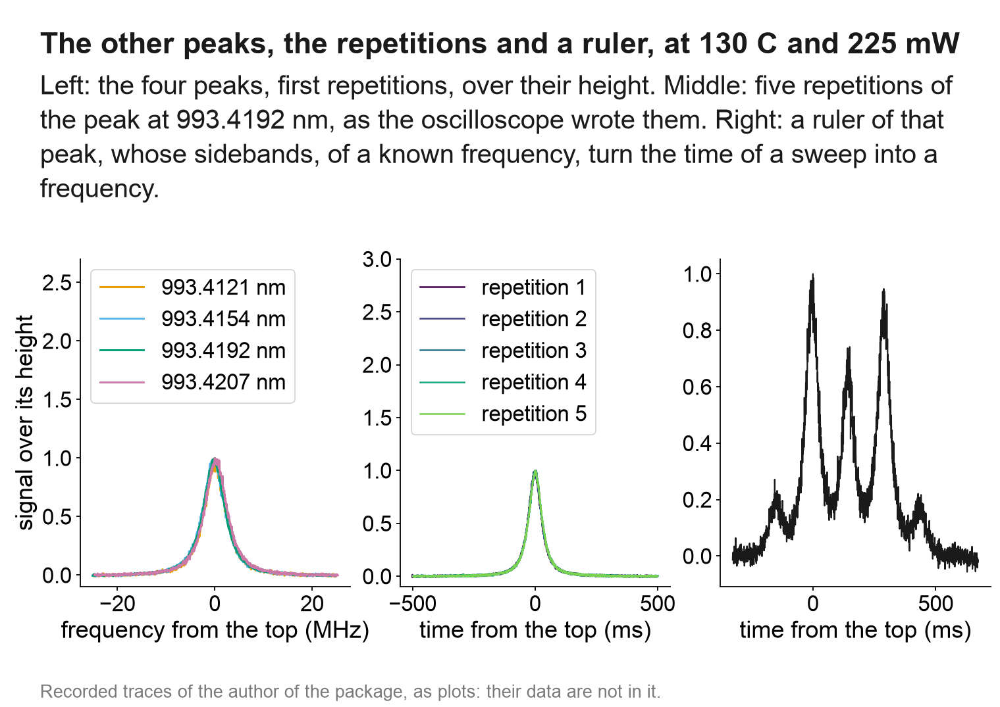
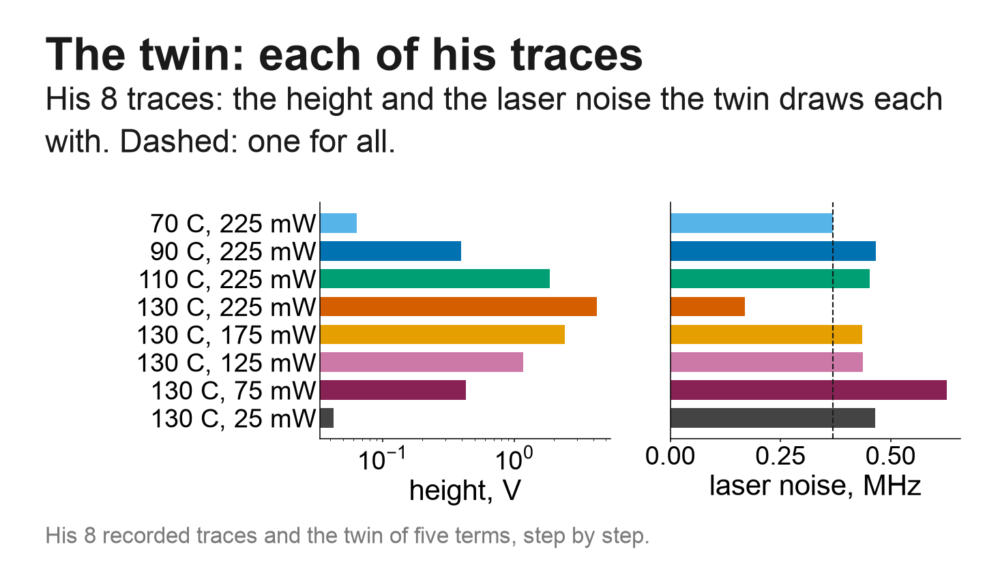
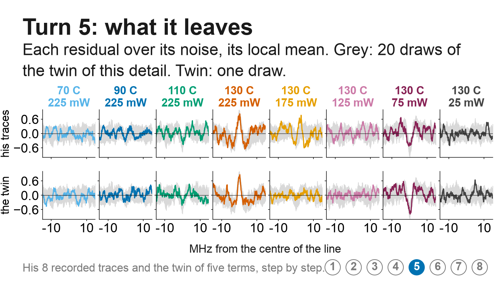
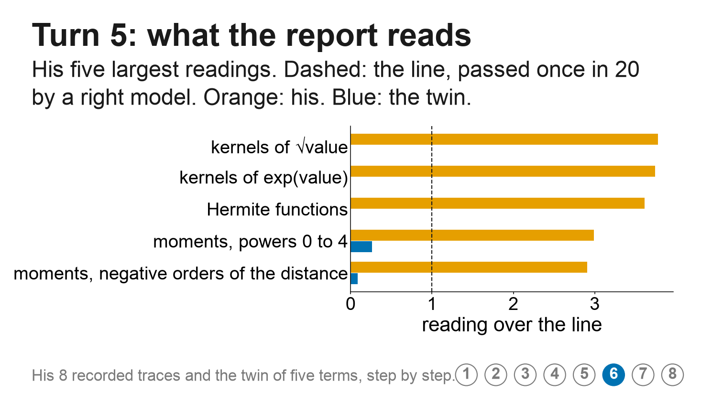

# A real case: the two photon line of rubidium

These figures show recorded traces of the two photon line of rubidium from 5S to 6S, measured by the author of the package. They are given as plots alone: the samples are not in the package, only the pictures and, printed on the figures, the values that the fits read from them. There are 16 traces, in six figures: the eight conditions of one peak (four temperatures at one power and five powers at one temperature), and at one of those conditions the three other peaks, four further repetitions and a ruler.

*Figure 1. The eight traces of the peak at 993.4192 nm, fitted together under a model of five terms: the natural width, collisions between the atoms, a gas that permeated the cell, the noise of the laser, and the passage of the atoms through the beam. Below each trace, the residuals divided by the noise.*

*Figure 2. The report of where to search on those traces, beside one synthetic draw of the same model. On the recorded traces, the first answer that points to a term is a change of the core along the power, at an excess of 3.59, where a synthetic set passes 2.84 five times in 100. Above it in the figure stand a family of statistics that reads the misfit through the square root of the value, at an excess of 10.7, and a noise skewed to one side, at 4.81. These two say how the misfit is read and what the noise is like, and point to no term.*

That answer stands just past its line, at 1.26 times it, on 30 sets. A model that lacks nothing shows such an excess on some of its synthetic sets, so the package reads the answer again on 100 sets before a term is written. If it holds, something varies with the power that the five terms do not hold. The package names the change and not its cause. In this line, the light shift of the probe, a broadening by the power and saturation each vary with the power, and a term for each, tried by the loop against its twin, tells them apart.

*Figure 3. At 130 C and 225 mW, the four peaks over their height, five repetitions of one peak as the oscilloscope wrote them, and a ruler, whose sidebands of known frequency turn the time of a sweep into a frequency.*

The following three figures are slides of the author's report, which sets the recorded traces beside synthetic traces drawn from a model of the five terms whose values follow their joint fit. Those synthetic traces are the project that `python -m twinfit example rubidium DIR` writes.

*Figure 4. The height and the laser noise with which the synthetic traces are drawn, for each of the eight conditions.*

*Figure 5. The residuals of the fit of the five terms on the recorded traces.*

*Figure 6. The statistics of the report that pass the line of the twin, the line that a right model passes once in 20.*

`python -m twinfit example rubidium DIR` writes those synthetic traces as a project: the eight traces, their description and a first model of one Lorentzian line, so that the loop runs on it as on the recorded traces. The values that drew them are in `examples/rubidium_twin/truth.json`, outside the project.

These are readings of the package on one set of recorded traces, not measurements. Figures 1 and 2 are pages of the folder of the author's model, whose foot names the files that made them. `python -m twinfit guide rubidium` prints this page with the folder of its figures.
