# The tutorial of twinfit

This tutorial takes you from nothing to the best model of a set of curves, with the uncertainty of each of its parameters and six proposals, three for the model and three for the experiment. It runs on two worked projects that the package writes, one of nuclear magnetic resonance and one of chromatography, so nothing of yours is needed to follow it. Their curves were drawn from a known truth, so you can see whether the package finds it.

It builds on the five minutes of the README and sets out the whole path of the package, its words, its reports and its choices. Not covered here: the protocol of an agent, which `agent/AGENT.md` gives, and the projects of other fields, which `EXAMPLES.md` gives.

> Section 1 below defines every word that the package and its other pages use.

Every command below was run as it is written, in an empty folder, and every output is what it printed. `python -m twinfit.tutorial --check`, with matplotlib installed by `pip install "twinfit[log]"`, runs them all again, in a temporary folder, and says whether any output changed. Here the whole of it ran in 55 seconds. A machine busy with other work takes longer.

## 1. Purpose and vocabulary of the package

You give it curves recorded across a design, such as spectra at several temperatures, and the model that should describe them. It fits the model to every curve at once. It reads the structure of what the fit leaves, the residuals, with families of statistics: generalized moments of the residuals and of their transformations, and windows along the abscissa and along the value. It reads how that structure changes from one setting of the design to the next.

It sets every reading against a twin: synthetic curves drawn from the fitted model with the noise of the records, fitted and read the same way. The twin draws the noise of each sample from a normal law of the deviation that the description gives it, apart from the others: where a counter gives few counts, as under about 20, its noise is skewed, and the twin does not hold that.

The loop, `python -m twinfit loop`, does all of it on a folder: it fits the first model, reads it against its twin, writes a report of where to search, then fits each term that you write in turn, keeps or refuses it, and writes the best model with the uncertainty of each parameter. Where the records stand beyond the twin, the model lacks something, and the report says where in the curves, of which kind, and along which setting. You write a term in answer. The package fits it, keeps or refuses it, and says what it does to the other parameters.

The package names a place, a kind and a setting. It never names a cause: which term of physical origin fills them is your choice, or the choice of an agent in your place.

The words that the rest of this page uses, each once:

- **A curve** is one recording, a spectrum or a chromatogram, as a column of abscissas and one of values. The description calls its file a trace, and the package calls a curve with its noise a record: the three words name one thing.
- **A setting** is a quantity under which a curve was taken and that the description gives for it, as the temperature of the sample. The package calls a setting that changes from curve to curve a covariate. The settings of one curve, by name, are its `design`, the dictionary that the model receives.
- **A bar** is the standard deviation of a parameter that a fit gives from the curvature of its chi square. **First order** is the model taken as straight in its parameters about the fit, so that bar is a first order bar.
- **A shared parameter** is one value for every curve, as a width. **An own parameter** is one value for each curve, as its height. The known parameters are the shared ones: those that the analysis is after, known in the sense that the model names them, and not that their values are known. The value of an own parameter in one curve is an own value, and the pages say an own value moves where it changes from curve to curve beyond its bars.
- **An ansatz** is a value held before the fit, with its uncertainty, from outside the records: section 9 writes one. **A lever** is a change of the experiment that the proposals weigh on the twin, as a quieter detector: section 8 reads them.
- **The coverage and the bias on the twin** of a parameter: on synthetic sets drawn from the fitted model, the share on which its interval of 1.96 bars of the fit holds the value that made them, near 0.95 where the bar is right, and the mean of its fitted values less that value, in bars. Section 6 reads them.
- **A scatter** is the standard deviation of a parameter over the synthetic sets of the twin, the spread of the estimate. A report gives a bias on the twin in scatters, and `best.md` in bars of the fit.
- **The level** of a curve is its baseline.
- **A generalized moment** is a sum over the samples of a residual times a weight of the abscissa: a power of the distance from the center of the curve, a fractional power, an inverse or a logarithmic weight, a cosine or a sine. It is also taken of the derivative of the curve, of its running integral, of its logarithm, and as a ratio of two moments.
- **A window** keeps the samples of a pair of intervals at equal distances from the center, a window along the abscissa, or the samples whose fitted value lies between two levels of its height, a window along the value.
- **A kernel** is the weight of a generalized moment. The report names each family of statistics by its kernels and its windows, as "moments: powers 0 to 8", "inverse and logarithmic kernels", "the two sides subtracted: pairs of intervals" or "the crossings of nine levels", the abscissa where the curve crosses each of nine levels of its height.
- **The excess** of an answer is its statistic on the records less the median of the same statistic on the synthetic sets, over the span from that median to their 95th percentile. An answer is beyond the twin where its excess passes a line, the largest excess that the synthetic sets of a right model reach on 95 of 100 of them: each report prints it, read on the twin of its model.
- **Two kinds tie** where their excesses lie within a factor of 1.5 of each other, and **two places tie** where their excesses differ by less than 1.96 standard deviations of their difference, read on 30 sets of a twin that carries the misfit, the fit plus what it leaves averaged over 9 samples. The records then do not tell them apart, the report names both, and a term of either is as asked.
- **The five parts of the uncertainty** of a value: its bar of the fit, its coverage and its bias on the twin, its bar of theory where values are held, and the spread over the models that the records cannot tell apart. Section 6 reads them.
- **The Bayesian criterion** of a model is its chi square plus the number of its fitted parameters times the logarithm of the number of samples. A model with one term more is kept when its criterion falls by more than 2.
- **The gain in chi square** of a proposal is how far the chi square falls when the shape that the residuals hold there is added to the model with one free size and every parameter fitted again. It ranks the directions beyond the twin, and it is not the fall for a term of your own, which the next run of the loop gives.
- **A profile** of a number that is chosen and not fitted, as the distance of a second component, is the best criterion at each value of it: the values within 1 of the best are its standard deviation. `python -m twinfit scan` draws it, section 10.
- **A Mechanism** is a term written in Python, section 11. **A rung** is one model of the loop: model 0, the first, and one rung more for each term kept on it.
- **Glitches** are a few samples far from the curve in one record. **A noise correlated from sample to sample** is a noise that moves neighboring samples together. The report names both among the kinds of a misfit, and no term of the curve fills them: they are read in the noise.
- **A chi function** is the cost that a fit gives each residual over its noise: its square in a plain fit, another function of it in a fit that weighs large residuals less. Where the residuals are those of the noise, the two fits agree.

## 2. Requirements and installation

Python 3.12 or later, with numpy 2.5 or later and scipy 1.16 or later, and matplotlib for the visual log of a run: numpy 2.5 convolves about ten times faster than numpy 1.26 on a Mac with an arm64 processor, and about as fast on Linux with an x86_64 processor, and the oldest versions that the package has run on are Python 3.12, numpy 2.5.0 and scipy 1.16.0.

Where the Python of your machine is called `python3`, or lives at a path of its own, type that in the place of `python` in every command of this page. Install the package from PyPI, `pip install twinfit`, or `pip install "twinfit[log]"` for matplotlib with it, or from a folder that holds it, `pip install /the/folder/that/holds/twinfit`, or put that folder on the path of Python, `export PYTHONPATH=/the/folder/that/holds/twinfit`. Then this prints the version of the package:

```bash
python -c "import twinfit; print(twinfit.__version__)"
```

```
0.1.0.post1
```

## 3. A worked project

This writes a project of nuclear magnetic resonance into a new folder, `my_nmr`:

```bash
python -m twinfit example nmr my_nmr
```

```
written into my_nmr: description.toml, model.py, an empty terms/, and 4 curves in traces/. Next: python -m twinfit loop my_nmr
```

It writes what a researcher writes before any fit:

```
my_nmr/
my_nmr/description.toml
my_nmr/model.py
my_nmr/terms/
my_nmr/traces/
my_nmr/traces/temperature_290.csv
my_nmr/traces/temperature_300.csv
my_nmr/traces/temperature_310.csv
my_nmr/traces/temperature_320.csv
```

**The curves**, one file a curve in `traces/`, with a line of names and then two columns, the abscissa and the value. The first lines of one:

`my_nmr/traces/temperature_290.csv`:

```
frequency,intensity
-20,0.052952
-19.9,0.066234
-19.8,0.064911
```

**The description of the data collection**, `description.toml`. It says what was measured, the abscissa and the value with their units, and each setting under which a curve was taken, here the temperature of the sample. Then one table a curve, with its file, its columns and its setting, and the noise of each sample, here one standard deviation for every sample. Then the addenda: the first model, which every description names, and what is optional, here three changes of the experiment that the proposals for the experiment weigh against each other.

A key that the package does not read is refused, so that a misspelled one is not dropped in silence. The order in which the curves were taken goes under `[problem]` as `order`, since a setting taken in the order of the time cannot be told from a drift:

`my_nmr/description.toml`:

```toml
[problem]
name = "nmr"
what = "one resonance of a sample measured at four temperatures. Each spectrum has its own height, frequency and baseline. The first model is one Lorentzian line of one width for all four"
abscissa = "frequency"
abscissa_unit = "Hz"
value = "intensity"
value_unit = "a.u."

[covariates.temperature]
unit = "K"

[[trace]]
file = "traces/temperature_290.csv"
columns = ["frequency", "intensity"]
temperature = 290

[[trace]]
file = "traces/temperature_300.csv"
columns = ["frequency", "intensity"]
temperature = 300

[[trace]]
file = "traces/temperature_310.csv"
columns = ["frequency", "intensity"]
temperature = 310

[[trace]]
file = "traces/temperature_320.csv"
columns = ["frequency", "intensity"]
temperature = 320

[noise]
from = "value"
value = 0.01

[addenda]
model = "model.py"

[addenda.lever.quieter]
kind = "noise"
factor = 0.5
words = "a quieter detector, which halves the noise of each sample"

[addenda.lever.repeats]
kind = "repeats"
factor = 3
words = "each run made three times"

[addenda.lever.slower]
kind = "samples"
factor = 2
words = "twice the samples over the same span"
```

**The first model**, `model.py`: the curve as a function of the abscissa `x`. Its parameters are `SHARED` by every curve or `OWN` to each. Here it is one Lorentzian line of one width for all four spectra, each with its own height, place and baseline. `CENTRE` names the own parameter that places a curve, and `centre` returns it, so that the report can tell the core of a curve from its wings. `START_SHARED` and `start_own` give the fit its starts, and `BOUNDS_SHARED` the bounds of the shared parameters, a list of the lower bounds and one of the upper.

`model`, `SHARED`, `OWN`, `START_SHARED` and `start_own` are required, `CENTRE` and `centre` come together or not at all, and the rest is optional. `NAME` says the model in a few words, as the reports name it, and `HELD` holds the values that it reads and does not fit, section 9. `record` holds a curve, `record.x` its abscissa and `record.y` its values, and `design` its settings by name, as the description gives them:

`my_nmr/model.py`:

```python
"""The first model of the spectra: one Lorentzian line of one width, on its own height, place and baseline."""
import numpy as np

SHARED = ("width",)                     # the full width of the line at half its height, in Hz, the same for every spectrum
OWN = ("height", "place", "baseline")   # of each spectrum
START_SHARED = [2.0]
BOUNDS_SHARED = ([0.05], [20.0])
CENTRE = "place"
NAME = "one Lorentzian line of one width"
EQUATION = r"$\frac{h}{1 + (2\,(x - x_0)/w)^2} + b$"          # the model in mathtext, which the visual log writes at each turn
LETTERS = {"h": "the height", "x_0": "the place", "w": "the full width at half height", "b": "the baseline"}          # each letter of EQUATION, which the visual log writes under it


def model(x, shared, own, design):
    return own[0] / (1.0 + (2.0 * (x - own[1]) / shared[0]) ** 2) + own[2]


def start_own(record):
    return [float(record.y.max() - record.y.min()), float(record.x[np.argmax(record.y)]), float(np.median(record.y))]


def centre(shared, own, design):
    return own[1]
```

## 4. The first run

The loop runs here in the foreground, since each run of this section takes a minute or two. A run of your own records may take an hour: start it in the background with `nohup`, `nohup python -m twinfit loop DIR > DIR/run.log 2>&1 &`, and read its end with `python -m twinfit wait DIR`, as the card of the guide for agents runs it in the background, so that a closed window or the limit of a tool does not stop it.

```bash
python -m twinfit loop my_nmr
```

```
model 0: the first model is fitted, and its twin and its report are read on 30 synthetic sets
best.md: the five parts of each value of the best model, on 30 synthetic sets
kept: nothing. Refused: nothing. The best model: model 0.
The report of each model and the output are in my_nmr/loop. Write my_nmr/terms/01.py with the next term, then run the loop again. An own value moves from curve to curve, which no question of the report reads: best.md says which, and how to write it.
The visual log: my_nmr/loop/log.pdf, 10 slides, one for each phase of each of 1 turn with the equation of each model and what each term does, the pictures in my_nmr/loop/log and their list in my_nmr/loop/log.md.
```

The loop fitted the first model, `model 0`, and wrote its report to `my_nmr/loop/model_0.md`. The report opens with the words that it uses:

`my_nmr/loop/model_0.md`:

```markdown
## The words of this page

- **The twin**: synthetic records drawn from this fitted model with the noise that the description gives, each fitted again as the records were. What the records show beyond what the twin shows is what the model lacks.
- **The bar of the fit**: the standard deviation of a parameter that the fit gives from the curvature of its chi square, at first order. The first order bound is that bar.
- **A scatter**: the standard deviation of a parameter over the synthetic sets of the twin, which the rule of the twin calls the spread of the estimate. A bias of 3 scatters is a value three of its own spreads from the truth of the twin.
- **The excess** of an answer: its statistic on the records less the median of the same statistic on the synthetic sets, over the span from that median to their 95th percentile. An excess of 1 is the 95th percentile of the twin, and an excess under 0 an answer that the records show less than the median of the twin does.
- **The chance** of an answer: the share of the synthetic sets on which its statistic is as large as on the records. With 30 sets the smallest chance is 0.032, and the answers that share it are ordered by their excess.
- **The level** of a curve, in a polynomial of the level, is its baseline.
- **A search**: the fit of one synthetic set, which ends when its steps no longer lower its chi square. A **Mechanism** is a term written in Python, as section 11 of the tutorial shows.
- **Seen by**: the family of statistics that sees the misfit most. It says how the misfit is read, and not which term to add.
- **The known parameters**: the shared parameters of the model, those of every curve. **The rule of the twin**: the bands within which the fit of this model must give back, on its synthetic sets, the values that made them, its searches ending on nearly all sets, its bias under a share of its spread and its spread near its bar, for its bars to be read.
- **Beyond the twin**: an excess larger than 2.31, the largest excess that a synthetic set of a right model reaches on 95 of 100 of them. Some answer is beyond it on 5 of 100 sets where the model lacks nothing. The line is read on the twin of this model, so it differs a little from one model to the next.
- **The size** of a term: the one parameter that it adds, which `python -m twinfit terms` defines for each. For a term that adds a part of the curve it is the area of that part over that of the curve without it, so that its share of the whole is a / (1 + a), and never a distance.
```

Then the fit. Its chi square is 1923.0 on 1591 degrees of freedom, 1.21 for each, where a right model with a right noise gives 1 with a standard deviation of 0.035. So something is missing. The page says it in its first line:

`my_nmr/loop/model_0.md`:

```markdown
## The fit

- **Chi square**: 1923.0 on 1591 degrees of freedom, 1.21 a degree of freedom, above 1 by more than three of its standard deviations, 0.035 each: the model lacks something, or the noise is stated too small.
- **The twin admits the fit**: the fit of this model gives back, on synthetic sets drawn from it, the values that made them, within the bands of its rule. That says the fit can be read, and not that the model is right.
- **What the twin measured**, each bias in spreads of the estimate on its own sets: searches ended on 1.00 of the sets. width: a bias of -0.32 of its spread, a spread of 0.83 of its bar of the fit, an interval that holds the truth on 0.97 of the sets.
- **The rule of the twin**: searches ended on 0.98 of the sets, a bias under 0.548 of the spread, a spread of 0.606 to 1.39 of the first order bound, an interval that holds the truth on 0.831 to 1 of the sets. With 30 sets each of these is known only within its standard error, so each band is widened to three of them. The bands as stated are a bias under 0.25, a spread of 0.85 to 1.15 and a coverage of 0.92 to 0.98, and from 475 sets on they are held as stated. The verdict above used the wider bands, since the twin read 30 sets.
- **The noise**: The twin draws its synthetic sets at the noise that the description gives, so it takes that noise as right: its coverage and its bias cannot see a noise stated wrong. The residuals against the height of the fitted curve say whether it is. The mean squared whitened residual, the residual over the noise of its sample squared, in 6 bands of the height of the fitted curve above its lowest value, from low to high: 1.08, 0.92, 1.10, 0.81, 1.07, 2.20, where 1 is right. Not every band is 1 within three standard errors: there the noise that the description gives is not that of the records, or the model misses. Where the report finds an answer of the curve beyond the twin, a place, a kind or a setting, read it first as the model that misses, and read this check again once the term is in. Where the answer that leads is one of the noise, a noise that grows with the curve or glitches, the noise comes first, as the section of the proposals says. Where nothing stands beyond the twin and a band still is not 1, the noise is wrong there: a band above 1 says that the stated noise is too small at that height, and the bars of the fit too small by about the square root of the band, and a band under 1 the reverse. `[noise] from = "residuals"` in the description reads it from the second differences of what the first model leaves, which a term that the model lacks, smooth over three samples, does not reach, or give a law of your own. The bands outside: 2.20 +- 0.09, 13.9 of its standard errors from 1.

| parameter | value | bar of the fit |
|---|---|---|
| width | 2.1367 | 0.0049 |
```

The twin admits the fit: it gives back the width that made it. But the check of the noise fails in its highest band, where the line is tallest. That check cannot tell a noise stated wrong from a model that misses. While the report finds an answer beyond the twin, as here, read it as the model that misses, and read the check again once the term is in, as section 6 does. Until then `best.md` marks the coverage and the bias on the twin as not to be read.

Then the first answer of each question. An answer stands beyond the twin past a line. An excess of 1 is the 95th percentile of one answer on the synthetic sets, but the report reads many answers at once, so its line is higher: the largest excess of all the answers together that a set of a right model reaches on 95 of 100 sets. Some answer then passes the line on 5 of 100 sets of a right model, and not each answer on 5 of 100:

`my_nmr/loop/model_0.md`:

```markdown
## Where to search

Read on 30 synthetic sets. The first answer beyond the twin of each question, beyond meaning an excess above 2.31 here:

| question | what it asks | first answer beyond the twin | its excess |
|---|---|---|---|
| where | the core of the curves, their flanks, their wings or their asymmetry | the core, read along a setting, the core along temperature: no place stands beyond the twin alone | 48.4 |
| shape | how the residuals are shaped: a slow trend over the span of each curve, or a periodic structure | none beyond the twin. The largest: a slow trend over the span of each curve | 0.0 |
| what | glitches, a noise that grows with the signal, or a noise correlated from sample to sample | none beyond the twin. The largest: a noise that grows with the signal | 1.2 |
| changes along | which part of the residuals changes from curve to curve along a setting, read on the residuals themselves | the core along temperature | 48.4 |
| seen by | the family of statistics that sees the misfit most | moments: negative orders of the distance | 57.6 |
| noise | the shape of the noise: skewed to one side, or with heavy tails | none beyond the twin. The largest: a noise skewed to one side | 1.1 |
```

Read it row by row. No place stands beyond the twin on its own, no shape and no law of the noise, but what the fit leaves changes along the temperature, in the core of the lines and in their flanks, so the row of where names the core, read along that setting. The package says no more than that: it names no term. The term is yours, from the physics of the curves.

Where two places stand beyond the twin and the records scatter their excesses alike, the row names both, tied: the report reads the scatter of each excess on sets drawn from the fit plus what the fit leaves, and the records do not tell which of the two leads.

In a resonance, what changes the core and the flanks of a line together with the temperature of the sample is its width, which the motion of the molecules sets. The proposals for the model are the directions of the report, each measured with the shape that the residuals hold there, fitted beside the model. On their twin that shape tells what a term of that place and that setting would cost the width if it were real:

`my_nmr/loop/model_0.md`:

```markdown
## Three proposals for the model

Each is a direction read on the residuals, for an answer of where, of shape or of what changes along a setting: those beyond the twin first, then by the gain in chi square that the shape that the residuals hold there brings when it is fitted beside the model. The package names no term: which term of physical origin has that place, shape and setting is the researcher's to say, in a term file. On its twin, synthetic curves drawn with the term at its fitted size are fitted without it and with it: the bias without it is what the term would cost the known parameters if it were real, and says nothing of whether it is.

In the names of the proposals a width is the full width of the fitted curves at half their height above their median value, here 2.1 in the unit of the abscissa: where the wings of a curve fill its window, it is narrower than the width at half its peak, and it is not a parameter of the model. Above the centre is toward larger abscissa.

- the shape that the residuals hold in the flanks, changing along temperature, for the residuals in the flanks change along temperature, beyond the twin at an excess of 45.4: a gain in chi square of 4.0
  - if the term were real at that size, width would be biased on its twin by 1.1 scatters, 0.0061 in its own unit, without it and by 0.0 scatters, 3.1e-05 in its own unit, with it: what the term would cost, and not a sign that it is real. A scatter of a model that lacks a term can be many bars of its fit. This shape is read on the residuals, which hold none of what the fit took into its own parameters, so this cost is a lower bound: a term of the physics in this place may cost far more
- the shape that the residuals hold in the core, changing along temperature, for the residuals in the core change along temperature, beyond the twin at an excess of 48.4: a gain in chi square of 2.4
  - if the term were real at that size, width would be biased on its twin by -0.9 scatters, -0.005 in its own unit, without it and by 0.0 scatters, 0.00027 in its own unit, with it: what the term would cost, and not a sign that it is real. A scatter of a model that lacks a term can be many bars of its fit. This shape is read on the residuals, which hold none of what the fit took into its own parameters, so this cost is a lower bound: a term of the physics in this place may cost far more
- the shape that the residuals hold in the wings, changing along temperature, for the residuals in the wings change along temperature, beyond the twin at an excess of 6.6: a gain in chi square of 1.9
  - if the term were real at that size, width would be biased on its twin by 0.1 scatters, 0.000544 in its own unit, without it and by 0.0 scatters, -1.57e-05 in its own unit, with it: what the term would cost, and not a sign that it is real. A scatter of a model that lacks a term can be many bars of its fit. This shape is read on the residuals, which hold none of what the fit took into its own parameters, so this cost is a lower bound: a term of the physics in this place may cost far more
```

A width in the page of the proposals is a unit of their own: the full width of the fitted curves at half their height above their median value, as the page says above its list. It is not the parameter `width` of `model.py`, which here is a full width too, and in section 10 a standard deviation.

The first direction is the one whose shape lowers the chi square most, and a term that takes part of another's misfit can lead: on records that lack a slope of the baseline, a second component written first can be kept, and fall to nothing once the slope is written. A term kept first is not looked at again when a later one arrives, so `best.md` names a kept term that has fallen within two bars of none, and the model without it is tried in a copy, as section 7 says.

The row seen by names the family of statistics that sees the misfit most. A family turns the residuals into a few numbers: the moments of the abscissa, and of the distance from the center to whole, fractional and negative powers, the same under logarithmic, exponential and Gaussian kernels, Hermite functions about the center, windows along the abscissa and along the value, the crossings of levels of the height, the moments of the derivative and of the running integral, and the moments of the square, the root, the logarithm, the reciprocal and the exponential of the value, which weigh the top of a line and its foot otherwise than the value does.

A term that the model lacks moves each family in its own way, and the pattern across the families is what the report reads. `python -m twinfit matrix` prints those readings for the model that the term files of a folder give, with no twin, in a few seconds:

```bash
python -m twinfit matrix my_nmr
```

```
The families of statistics on the model of my_nmr, its first model, each term file kept by the Bayesian criterion alone. No twin is run: a level here is that of a chi square under a right model at first order, which the families of many statistics do not reach, and the report of the loop gives the levels of the twin.

## What each family reads

Each family turns the residuals into a few statistics. Its reading is their chi square in the covariance that they have under a right model, with as many degrees of freedom as the family has directions that the model does not hold. The smallest levels first.

| family | chi square | degrees of freedom | level |
|---|---|---|---|
| moments: negative orders of the distance | 336.0 | 16 | 8.6e-62 |
| the exponential of the value: power kernels 0 to 8 | 379.1 | 36 | 7.7e-59 |
| the square of the value: power kernels 0 to 8 | 378.2 | 36 | 1.2e-58 |
| moments: inverse and logarithmic kernels | 352.4 | 27 | 2.2e-58 |
| ratios of moments of the distance: orders 0.5 to 4 over order 0 | 357.8 | 32 | 1.1e-56 |
| moments: fractional powers of the distance | 330.6 | 24 | 1.1e-55 |
| moments: exponential and Gaussian kernels | 355.3 | 36 | 3.9e-54 |
| the two sides added: pairs of intervals, the centre held | 333.2 | 28 | 5.8e-54 |
| Hermite functions about the centre: orders 3 to 8 | 314.6 | 28 | 3e-50 |
| the reciprocal of the value: power kernels 0 to 8 | 318.5 | 36 | 5.8e-47 |
| the square root of the value: power kernels 0 to 8 | 314.9 | 36 | 2.9e-46 |
| windows along the value: bands between levels of the height, each side | 415.9 | 84 | 1.9e-45 |
| the logarithm of the value: power kernels 0 to 8 | 308.8 | 36 | 4.4e-45 |
| windows along the abscissa: pairs of intervals, the two sides added and subtracted | 345.4 | 52 | 6.3e-45 |
| moments: powers 0 to 8 | 244.2 | 32 | 1.6e-34 |
| moments of the running integral: powers 0 to 8 | 244.9 | 36 | 6.7e-33 |
| moments of the derivative: powers 0 to 8 | 232.2 | 36 | 1.6e-30 |
| the abscissa against the value: the crossings of nine levels, each side | 296.2 | 72 | 5.7e-29 |
| moments: powers 0 to 4 | 131.6 | 16 | 3.2e-20 |
| moments: cosines and sines | 99.5 | 32 | 7.7e-09 |
| every sample: the fit | 1923.0 | 1591 | 1.6e-08 |
| the two sides subtracted: pairs of intervals | 20.0 | 28 | 0.86 |

## The shape of the noise

The whitened residuals of every curve as they stand, their skewness over its standard error under a normal law and their excess kurtosis over its own, each a standard normal deviate at first order where the noise is normal. A misfit of the mean leaves tails of its own, and the report reads them once the shape that leads is taken out: a noise skewed to one side 1.16, a noise with heavy tails 2.12.

## Which statistic sees which law of the noise

Each law of the noise is drawn 400 times on these records, whitened and of unit variance on every sample, so that the noise that the description states stays right on average and only its law is wrong, and taken through the fit as the residuals take it. The line of each statistic is where it stands on 95 of 100 draws of a normal noise of the same design, so each cell is a chance by simulation at the level 0.05, and owes nothing to first order. After the families come the five readings of the noise that the report gives, the records together, and two opponents that practitioners read, the runs test and Durbin and Watson, which the report does not read. The last row reads every other statistic at one line, as the report reads its answers: the chance that the largest excess of them all passes where a normal noise stands on 95 of 100 draws. The laws:

- normal: a normal noise as the description states it, drawn again: each of its cells is the level that the line holds
- correlated: a noise correlated from one sample to the next by 0.5 in the order of the abscissa
- heavy tails: Student's t of 3 degrees
- skewed: a chi square of 4 degrees less its mean
- grows with the signal: a variance in proportion to the height above the foot of the fitted curve plus a tenth of its span
- glitches: one sample in 500 at six deviations

| statistic | normal | correlated | heavy tails | skewed | grows with the signal | glitches |
|---|---|---|---|---|---|---|
| moments: powers 0 to 4 | 0.05 | 0.93 | 0.08 | 0.06 | 0.01 | 0.04 |
| moments: powers 0 to 8 | 0.04 | 1.00 | 0.07 | 0.04 | 0.01 | 0.04 |
| moments: fractional powers of the distance | 0.04 | 0.97 | 0.08 | 0.04 | 0.52 | 0.04 |
| moments: inverse and logarithmic kernels | 0.06 | 0.99 | 0.08 | 0.05 | 0.48 | 0.05 |
| moments: negative orders of the distance | 0.05 | 0.88 | 0.10 | 0.06 | 0.81 | 0.07 |
| moments: exponential and Gaussian kernels | 0.05 | 0.99 | 0.09 | 0.05 | 0.74 | 0.07 |
| Hermite functions about the centre: orders 3 to 8 | 0.04 | 0.97 | 0.08 | 0.04 | 0.72 | 0.04 |
| moments: cosines and sines | 0.07 | 0.98 | 0.09 | 0.08 | 0.01 | 0.06 |
| windows along the abscissa: pairs of intervals, the two sides added and subtracted | 0.07 | 0.99 | 0.12 | 0.10 | 0.96 | 0.10 |
| the two sides added: pairs of intervals, the centre held | 0.05 | 0.94 | 0.09 | 0.07 | 0.70 | 0.06 |
| the two sides subtracted: pairs of intervals | 0.07 | 0.94 | 0.10 | 0.09 | 0.86 | 0.07 |
| windows along the value: bands between levels of the height, each side | 0.05 | 0.95 | 0.13 | 0.11 | 1.00 | 0.10 |
| the abscissa against the value: the crossings of nine levels, each side | 0.07 | 0.77 | 0.15 | 0.13 | 1.00 | 0.08 |
| moments of the derivative: powers 0 to 8 | 0.04 | 0.99 | 0.09 | 0.04 | 0.01 | 0.05 |
| moments of the running integral: powers 0 to 8 | 0.04 | 1.00 | 0.08 | 0.04 | 0.01 | 0.04 |
| ratios of moments of the distance: orders 0.5 to 4 over order 0 | 0.06 | 0.98 | 0.10 | 0.06 | 0.78 | 0.07 |
| the logarithm of the value: power kernels 0 to 8 | 0.07 | 0.95 | 0.11 | 0.12 | 0.84 | 0.09 |
| the reciprocal of the value: power kernels 0 to 8 | 0.04 | 0.93 | 0.10 | 0.11 | 0.74 | 0.08 |
| the square of the value: power kernels 0 to 8 | 0.07 | 0.96 | 0.10 | 0.08 | 0.84 | 0.06 |
| the square root of the value: power kernels 0 to 8 | 0.07 | 0.97 | 0.10 | 0.12 | 0.86 | 0.07 |
| the exponential of the value: power kernels 0 to 8 | 0.06 | 0.95 | 0.10 | 0.09 | 0.80 | 0.06 |
| every sample: the fit | 0.04 | 0.03 | 0.25 | 0.17 | 0.07 | 0.14 |
| glitches | 0.09 | 0.00 | 1.00 | 0.98 | 1.00 | 0.95 |
| a noise skewed to one side | 0.05 | 0.05 | 0.84 | 1.00 | 0.47 | 0.39 |
| a noise with heavy tails | 0.05 | 0.07 | 1.00 | 1.00 | 1.00 | 0.93 |
| a noise that grows with the signal | 0.04 | 0.00 | 0.41 | 0.14 | 1.00 | 0.07 |
| a noise correlated from sample to sample | 0.07 | 1.00 | 0.05 | 0.05 | 0.19 | 0.05 |
| the records together: every record added in bins of the abscissa | 0.03 | 0.93 | 0.06 | 0.02 | 0.01 | 0.02 |
| the opponent: the runs test of the signs, record by record | 0.05 | 1.00 | 0.06 | 0.04 | 0.06 | 0.05 |
| the opponent: Durbin and Watson, the lag one correlation, record by record | 0.07 | 1.00 | 0.09 | 0.06 | 0.05 | 0.07 |
| every statistic at one line, as the report reads them | 0.04 | 1.00 | 1.00 | 1.00 | 1.00 | 0.94 |
```

Its first table is what each family reads: a chi square with its degrees of freedom, and its level at first order, which a family of many correlated statistics does not reach, so the report takes its levels from the twin. The chi square of every sample reads 1923 on 1591 degrees of freedom, 1.21 for each, while the exponential of the value: power kernels 0 to 8 reads 379 on 36: a misfit of one shape stands in a few directions, which a family of few directions gathers and the sum over every sample spreads over all of them.

The table of the noise asks the same of its law. Each law is drawn on these curves at the variance that the description states, so that only its law is wrong, and the line of each statistic is set where a normal noise of the same design leaves it on 95 draws of 100: the column of a normal noise drawn again reads from 3 to 8 cases of 100, the level.

A noise correlated from one sample to the next lights every family, in 77 to 100 cases of 100, and the plain fit in 3. So on curves whose noise is correlated, a family past its line is no sign of a missing term, and the reading of the neighbors, which reports that noise in 100, says which it is.

Heavy tails and a skewed noise keep the covariance of the noise, so no family, linear in the residuals, reports them in more than 15 cases of 100, and the readings of the shape of the noise do. A noise that grows with the signal changes the covariance along the height, so the windows along the value report it, and the moments of the powers of the abscissa do not.

## 5. A term

A term is a file in `terms/`, `01.py`, then `02.py`, and so on, which you write. This prints the terms that a term file can name, each with the one parameter that it adds, and the form of a term file:

```bash
python -m twinfit terms
```

```
The terms of the package, each with the one parameter a that it adds:

    widened(size)            the curve convolved with a two sided exponential kernel of scale size(design) * sqrt(a), size a
                             number or a function of the settings of a curve, as lambda design: 0.5
    displaced(reach)         a mixture of copies of the curve displaced by reach(design) * sqrt(a) * v, v from 0 to 1 of
                             density 2 v, reach a number or a function of the settings, as for widened. About its mean,
                             its long side points toward smaller abscissa where reach is positive, toward larger where
                             it is negative: the opposite of second, whose positive distance is after the curve
    along(parameter, key, power=1)
                             a shared parameter, named as SHARED names it, that changes along a setting of the description,
                             named as its [covariates] names it: p (1 + a z), z the setting less its mean over the
                             records, over its standard deviation over them, taken with their number, not one less.
                             power=2 takes z squared less its mean
    gaussian_width(along=None)
                             the curve convolved with a Gaussian of standard deviation a, in the unit of the abscissa, on
                             the steps of the records, which need equal steps: a width that the line lacks, as the noise
                             of a source or the response of an instrument. along, the name of a setting or a function of the settings of a curve, scales a in it
    lorentzian_width(along=None)
                             the same with a Lorentzian of full width a at half its height: a width of a lifetime, and
                             along="concentration" makes it in proportion to that setting over its mean over the
                             records, a the width at that mean, and names it
    pedestal(stretch)        a copy of the curve `stretch` times wider under it, of relative area a, 0 or more unless
                             `lower` says otherwise, stretch a number
    bent()                   the abscissa is not linear: x + a (x - middle)^2 / half its span
    second(distance)         a second copy of the curve, `distance` away along the abscissa, in its unit, after the curve
                             where it is positive and before it where negative, of relative area a, 0 or more unless
                             `lower` says otherwise
    tail(stretch, side)      a copy of the curve `stretch` times wider on one side of its centre alone, of relative area a,
                             side "upper" or "lower". A wider copy, not the exponential tailing of a column or of a
                             detector, which a Mechanism of your own writes
    level(power)             a power of the abscissa under every curve, of one size for all: a ((x - middle) / half)^power,
                             the middle and the half span those of the abscissas of all the records together, power 1, 2
                             or 3 for a slope, a curvature or a cubic term of the baseline
    periodic(period, part)   a cosine or a sine of the abscissa of one period, in its unit, part "cosine" by default or
                             "sine": a cos or a sin(2 pi (x - centre) / period), about the centre of each curve. A ripple
                             fixed to the abscissa, the same on every curve whatever its centre, as the fringe of an
                             etalon, is a Mechanism of your own with x in the place of x - centre:
                             section 11 of the tutorial writes one

Glitches and a change of the noise are no term of the mean: they are read in the weights of the fit, the noise of each
sample that the description gives. Each term here is made of copies of the curve, wider, displaced or on one side: a shape
that the physics names otherwise, as the exponential tail of a detector or of a column, is a Mechanism of your own. The report
gives the place, the shape and the setting of a misfit, and never the name of a term: which term of physical origin fills it
is the researcher's to say. A Mechanism is Mechanism(name, kind, parameter, start, wrap,
lower=-inf, upper=inf): kind is a word that the package keeps with the term and reads in no result, lower and upper bound
the new parameter, and wrap(model, problem, n) returns any curve, the line replaced as well as a term added to it.

The name that a report and best.md give a term, and the call of a term file that writes it:

    a kernel with exponential wings               widened(0.5)
    a displacement of linear density              displaced(0.5)
    a pedestal 8 times wider than the curve       pedestal(8)
    a quadratic map of the abscissa               bent()
    a second component 1.5 away                   second(1.5)
    a tail on the upper side, 2 times wider       tail(2, 'upper')
    a power 1 of the abscissa under every curve   level(1)
    a cosine of period 3                          periodic(3.0)
    a sine of period 3                            periodic(3.0, 'sine')
    width changes along concentration             along('width', 'concentration')
    a Gaussian width beside the line              gaussian_width()
    a Lorentzian width beside the line            lorentzian_width()
    an exponential width beside the line          exponential_width()

A term file is DIR/terms/01.py, then 02.py, and so on, one term each, read by the loop in that order:

    from twinfit import mechanisms
    term = mechanisms.along("width", "concentration")
    why = "the report: the core changes along concentration, and a width grows with the concentration of the sample"

`term` is one of the terms above, or a mechanism of your own, and `why` says why you add it, in six words or more. A
file that is kept may be written again later: the loop fits every file again at each run. The loop fits the
model with the term and keeps it when three things hold: its fit ends inside its bounds, its Bayesian criterion falls
by more than 2, and the twin admits the larger model. The Bayesian criterion is the chi square plus the number of
fitted parameters times the logarithm of the number of samples, so a fall of more than 2 is a gain that one more
parameter does not buy alone. Otherwise it refuses the term, with the reason.

A term that the physics asks for and the records cannot show is held at its value of theory and not fitted: give the
term its theory, as mechanisms.pedestal(4.0, theory=(0.05, 0.01)), its size and the bar of that size, and write a line
hold = True in its file. The loop keeps it at that size whatever the criterion says, and carries its bar into the bar of
theory of every other value.
```

The report points to the core and the flanks changing along the temperature, and the physics of a resonance names the width. `along` makes a shared parameter change along a setting, here the width along the temperature. A term file adds `why`, the reason in six words or more:

`my_nmr/terms/01.py`:

```python
from twinfit import mechanisms
term = mechanisms.along("width", "temperature")
why = "the report: the core changes along temperature, and the width of a resonance changes with the temperature of the sample"
```

## 6. The second run

```bash
python -m twinfit loop my_nmr
```

```
model 0: the first model is fitted, and its twin and its report are read on 30 synthetic sets
01.py: width changes along temperature is fitted, and read on 30 synthetic sets: each term costs more than the one before it, since the model grows
best.md: the five parts of each value of the best model, on 30 synthetic sets
kept: 01.py, width changes along temperature. Refused: nothing. The best model: model 1.
The report of each model and the output are in my_nmr/loop. No answer of where, shape, what or changes along in the last report, nor a term of your list, stands beyond its twin: the records ask for no more, and a further term rests on theory alone. An own value moves from curve to curve, which no question of the report reads: best.md says which, and how to write it.
The visual log: my_nmr/loop/log.pdf, 19 slides, one for each phase of each of 2 turns with the equation of each model and what each term does, the pictures in my_nmr/loop/log and their list in my_nmr/loop/log.md.
```

Two words of these lines are defined here, since section 9 uses them later: your list is `list_of_terms.py` of the project, the terms that you suspect, empty at the start, and matched is the question of the report that reads the residuals against each term of that list. With the list empty, no answer of matched is read. The package holds a list of its own, read only where you run the loop with `--dictionary`: it names terms, and the search for a term that you do not suspect runs without it.

The loop kept the term. Its output is `my_nmr/loop/best.md`, the best model with the five parts of the uncertainty of each parameter: the bar of the fit, the coverage and the bias on the twin, the bar of theory and the spread over the models. Their words open the page:

`my_nmr/loop/best.md`:

```markdown
# The best model: model 1

Its terms: one Lorentzian line of one width, width changes along temperature.

- width changes along temperature, in 01.py, width along temperature: the report: the core changes along temperature, and the width of a resonance changes with the temperature of the sample

The description does not say in which order the curves were taken, `order` under [problem]: a setting taken in the order of the time cannot be told from a drift.

The best model is the one of the smallest Bayesian criterion, the chi square plus the number of fitted parameters times the logarithm of the number of samples. The models whose criterion is within 2 of it are those that the records cannot tell apart from it.

| model | its term | chi square | fitted parameters | Bayesian criterion | less that of the best |
|---|---|---|---|---|---|
| model 0 | the first model | 1922.97 | 13 | 2018.91 | 328.22 |
| model 1 | width changes along temperature | 1587.38 | 14 | 1690.70 | 0.00 |

## The words of the table

- **The value**: the fitted value of the parameter in the best model. A parameter that a term adds is defined by its term: `python -m twinfit terms` lists them.
- **The bar of the fit**: the standard deviation of the parameter that the fit gives at first order, from the curvature of its chi square.
- **The coverage on the twin**: the share of synthetic sets of the best model on which the interval of 1.96 bars of the fit holds the value that made them. 0.95 is right, and with the 30 sets read here a coverage is known within 0.04, one standard deviation. Well under 0.95, the bar of the fit is too small, and well over it, too large. The sets are drawn from fixed seeds, so a run gives the same numbers again, and two projects of one design and close values read close coverages: that coverage is one draw of its uncertainty, which more sets narrow.
- **The bias on the twin, in bars**: the mean of the values fitted on those sets less the value that made them, in bars of the fit. It is given beside the value and not taken out of it: `best.json` gives the value less it too.
- **The bar of theory**: where the model holds values of theory, half the move of the parameter when each held value is set one bar of theory below and above its centre. None held: the description holds no value of theory, which an ansatz in its addenda would, `[addenda.ansatz.NAME]` with its value and its uncertainty.
- **The spread over the models**: half the range of the parameter over the best model and the models that the loop fitted and that the records cannot tell apart from it. A term that was never written into a term file is in no model, so two terms that fit alike and were not both tried leave it at 0.
- **Not told apart**: a parameter correlated with another beyond 0.999 gets no bar of the fit, since the records fix a combination of the two and not each.

## The parameters

The twin draws its synthetic sets at the noise that the description gives, so it takes that noise as right: its coverage and its bias cannot see a noise stated wrong. The residuals against the height of the fitted curve say whether it is. The mean squared whitened residual, the residual over the noise of its sample squared, in 6 bands of the height of the fitted curve above its lowest value, from low to high: 1.04, 0.91, 1.02, 0.82, 1.03, 1.11, where 1 is right. Each is 1 within three standard errors.

| parameter | value | bar of the fit | coverage on the twin | bias on the twin, in bars | bar of theory | spread over the models |
|---|---|---|---|---|---|---|
| width | 2.1182 | 0.0050 | 0.87 | 0.19 | none held | 0 |
| width along temperature | 0.0433 | 0.0024 | 0.97 | -0.16 | none held | 0 |

Read on 30 synthetic sets, the coverage and the bias are provisional: `--sets 100` reads each coverage within 0.02.

## To quote

Each parameter as a value with the bar of the fit, then, as separate terms, the bar of theory and the half range over the models where they are not zero. Where one bar is asked, add them in squares, since each comes from another source. The bias on the twin is not taken out while it is under one bar. Where the noise, the coverage or the bias fails, the line says so.

- width: 2.1182 ± 0.0050 of the fit, at the mean of temperature over the curves, 305
- width along temperature: 0.0433 ± 0.0024 of the fit, a share of width for each deviation of temperature over the curves, 11.18: the line below gives it per unit
- height, place, baseline, of each curve: Each is in the section of the parameters of each curve with its bar of the fit, which counts what the shared parameters leave uncertain. The twin reads no coverage and no bias of them: quote each with its bar of the fit alone, and with the settings of its curve
- width grows by 0.00820 ± 0.00044 per unit of temperature: the size of its term times width over 11.1803, the deviation of temperature over the curves, with the bar that the covariance of the two gives. At each value of temperature: 290, 1.9952 ± 0.0089, 300, 2.0772 ± 0.0057, 310, 2.1592 ± 0.0052, 320, 2.2413 ± 0.0077

## Notes

- The bias on the twin here is in bars of the fit, on sets of its own: the report of each model reads it in spreads of the estimate, on other sets, so the two differ.
- The coverage on the twin here is read on sets of its own too, and a coverage counted on 30 sets scatters by about 0.04 from one draw of the sets to another: the coverage of a parameter in the report of its model can differ from this one by two or three times that, with no fault in either.
- The spread over the models reads the models of this folder alone. A form of a term tried in a copy, as a law of the physics in `model.py` in the place of a term of the package, is not in it: compare such forms by their Bayesian criterion and quote the range of their values beside the five parts.

## The parameters of each curve

Each with its bar of the fit, which counts what the shared parameters leave uncertain: the twin reads the shared ones alone. An own value that moves with a setting is a term of its own: read them down each column.

- height moves with temperature: a line through its values gives 0.00994 ± 0.00014 per unit of temperature, 69 bars from none, a chi square of 2.4 on 2 about the line. While height is own to each curve, no question of the report reads it: write it in `model.py` as shared parameters that read `design["temperature"]`, as section 9 of the tutorial shows, and the report reads what is left. Across 4 curves a line can also hold by chance, so ask whether the physics gives it.
- place moves with temperature: a line through its values gives 0.02983 ± 0.00014 per unit of temperature, 207 bars from none, a chi square of 1.1 on 2 about the line. While place is own to each curve, no question of the report reads it: write it in `model.py` as shared parameters that read `design["temperature"]`, as section 9 of the tutorial shows, and the report reads what is left. Across 4 curves a line can also hold by chance, so ask whether the physics gives it.

| curve | temperature | height | place | baseline |
|---|---|---|---|---|
| traces/temperature_290.csv | 290 | 0.9985 ± 0.0033 | -0.4462 ± 0.0036 | 0.05075 ± 0.00057 |
| traces/temperature_300.csv | 300 | 1.1033 ± 0.0030 | -0.1443 ± 0.0033 | 0.04963 ± 0.00056 |
| traces/temperature_310.csv | 310 | 1.1969 ± 0.0029 | 0.1496 ± 0.0031 | 0.05041 ± 0.00056 |
| traces/temperature_320.csv | 320 | 1.2991 ± 0.0032 | 0.4504 ± 0.0029 | 0.04973 ± 0.00059 |

Tried and refused: none.

The loop stops here: no answer of where, what or along stands beyond the twin, so the records ask for no more term. A term that the physics asks for is held at its value of theory, in terms/02.py, with hold = True.
```

The curves were drawn from a known truth, so the output can be checked. At the mean temperature, 305 K, the width was 2.12 Hz, and the fit gives 2.1182 ± 0.0050, 0.4 bars away. Its growth along the temperature, in the units of the term, was 0.0422, and the fit gives 0.0433 ± 0.0024, 0.5 bars away.

The heights and the places of the worked spectra were drawn to rise with the temperature, each spectrum its own, as an instrument whose gain and lock drift with it: `best.md` names them as moving with the temperature, with their slopes, and they stay own here, since the question of this example is the width. Section 9 says how such a value is written into the model where it is the question.

A proposal of the last report that stands within the twin is one that the records do not ask for: its line of what it would cost if it were real names a systematic to say beside the value where the physics allows such a term, and adds nothing to the bar. The worked descriptions do not say in which order their curves were taken, so `best.md` says that it is not known.

In hertz per kelvin the growth is the term's size times the width over the standard deviation of the temperatures, 11.18 K, taken over the four records with their number: 0.0082 Hz per kelvin, where 0.008 drew the curves.

Each run moves the `loop/` of the run before it to `loop.before/` while it works, puts it back where the run stops on a fault, and removes it where the run ends: so `loop/` is always the last whole run.

`loop/` holds, for each model K, its report `model_K.md`, its page for an agent `brief_K.md`, its numbers `model_K.json`, its residuals `residuals_K.csv` and what each of its terms does, `effects_K.npz`, then `equations.json`, `best.md` and `best.json`, `STATUS.json`, what the run is doing, `notebook/`, the record of every step of the run, and the visual log, `log.pdf`, its slides in `log/` and their list in `log.md`. A run that is refused writes `REFUSED.md` there, beside the files of the run before it.

`loop.before/` is removed where a run ends, so copy `loop/` where a run is to be kept. `loop.reuse/` keeps the twin, the report and the proposals of each model and the twin of each term: a run reads back what a run before it computed from the same files, records and fit, so a run after one more term file computes only what that file adds, and a run stopped at its budget goes on where it stopped.

Which number to quote: the value with its bar of the fit, when three things hold. The noise passes its check, as the line above the table says here. The coverage on the twin lies in the band of the rule of the twin at the number of sets read, the band that admits the fit: three standard deviations of a coverage about 0.95 with few sets, and 0.92 to 0.98 from 475 sets on, so that one rule says both whether the fit is admitted and whether its bar is quoted. And the bias on the twin is under one bar.

With 30 synthetic sets, the default, a coverage is known within 0.04, one standard deviation, so the coverage of the width, 0.87, is 2.1 of them from 0.95. The report of model 1 reads the same coverage on other sets, so its number differs: neither settles it on 30 sets, whose band is wide. Read it on more sets, and quote the run on 500 sets where the time allows, whose band is the one stated.

The section "To quote" of `best.md` writes each parameter that way, with the bar of theory and the half range over the models as separate terms where they are not zero, and says when a part forbids the quote:

```bash
python -m twinfit loop my_nmr --sets 100
```

```
model 0: the first model is fitted, and its twin and its report are read on 100 synthetic sets
01.py: width changes along temperature is fitted, and read on 100 synthetic sets: each term costs more than the one before it, since the model grows
best.md: the five parts of each value of the best model, on 100 synthetic sets
kept: 01.py, width changes along temperature. Refused: nothing. The best model: model 1.
The report of each model and the output are in my_nmr/loop. No answer of where, shape, what or changes along in the last report, nor a term of your list, stands beyond its twin: the records ask for no more, and a further term rests on theory alone. An own value moves from curve to curve, which no question of the report reads: best.md says which, and how to write it.
The visual log: my_nmr/loop/log.pdf, 19 slides, one for each phase of each of 2 turns with the equation of each model and what each term does, the pictures in my_nmr/loop/log and their list in my_nmr/loop/log.md.
```

`my_nmr/loop/best.md`:

```markdown
| parameter | value | bar of the fit | coverage on the twin | bias on the twin, in bars | bar of theory | spread over the models |
|---|---|---|---|---|---|---|
| width | 2.1182 | 0.0050 | 0.94 | -0.08 | none held | 0 |
| width along temperature | 0.0433 | 0.0024 | 0.96 | -0.05 | none held | 0 |

## To quote

Each parameter as a value with the bar of the fit, then, as separate terms, the bar of theory and the half range over the models where they are not zero. Where one bar is asked, add them in squares, since each comes from another source. The bias on the twin is not taken out while it is under one bar. Where the noise, the coverage or the bias fails, the line says so.

- width: 2.1182 ± 0.0050 of the fit, at the mean of temperature over the curves, 305
- width along temperature: 0.0433 ± 0.0024 of the fit, a share of width for each deviation of temperature over the curves, 11.18: the line below gives it per unit
- height, place, baseline, of each curve: Each is in the section of the parameters of each curve with its bar of the fit, which counts what the shared parameters leave uncertain. The twin reads no coverage and no bias of them: quote each with its bar of the fit alone, and with the settings of its curve
- width grows by 0.00820 ± 0.00044 per unit of temperature: the size of its term times width over 11.1803, the deviation of temperature over the curves, with the bar that the covariance of the two gives. At each value of temperature: 290, 1.9952 ± 0.0089, 300, 2.0772 ± 0.0057, 310, 2.1592 ± 0.0052, 320, 2.2413 ± 0.0077

## Notes

- The bias on the twin here is in bars of the fit, on sets of its own: the report of each model reads it in spreads of the estimate, on other sets, so the two differ.
- The coverage on the twin here is read on sets of its own too, and a coverage counted on 100 sets scatters by about 0.02 from one draw of the sets to another: the coverage of a parameter in the report of its model can differ from this one by two or three times that, with no fault in either.
- The spread over the models reads the models of this folder alone. A form of a term tried in a copy, as a law of the physics in `model.py` in the place of a term of the package, is not in it: compare such forms by their Bayesian criterion and quote the range of their values beside the five parts.
```

On 100 sets the coverages read 0.94 and 0.96, each within two of their standard deviations of 0.95: the bar of the fit holds, and it is the uncertainty to quote.

When the noise fails its check, the coverage and the bias on the twin are marked not to be read, since the twin draws its sets at the noise that the description gives: quote no bar until the noise is given right, by a column of the curves or a value, as section 9 says, and the check passes.

`best.md` also gives the own parameters of each curve, its height, its place and its baseline, each with its bar. Each run of the loop writes `loop/` again at its own number of sets, so the sections after this one, run at the default of 30, read 30 sets.

And the report of the new model finds nothing more beyond its twin:

`my_nmr/loop/model_1.md`:

```markdown
## Where to search

Read on 100 synthetic sets. The first answer beyond the twin of each question, beyond meaning an excess above 2.20 here:

| question | what it asks | first answer beyond the twin | its excess |
|---|---|---|---|
| where | the core of the curves, their flanks, their wings or their asymmetry | none beyond the twin. The largest: the wings | 0.1 |
| shape | how the residuals are shaped: a slow trend over the span of each curve, or a periodic structure | none beyond the twin. The largest: a slow trend over the span of each curve | 0.3 |
| what | glitches, a noise that grows with the signal, or a noise correlated from sample to sample | none beyond the twin. The largest: a noise that grows with the signal | 1.5 |
| changes along | which part of the residuals changes from curve to curve along a setting, read on the residuals themselves | none beyond the twin. The largest: the asymmetry along temperature | 0.3 |
| seen by | the family of statistics that sees the misfit most | none beyond the twin. The largest: the abscissa against the value: the crossings of nine levels, each side | 0.9 |
| noise | the shape of the noise: skewed to one side, or with heavy tails | none beyond the twin. The largest: a noise skewed to one side | 0.9 |

No answer of where, shape, what or changes along, nor of a term of your list, stands beyond the twin: on these records the model leaves nothing that its own synthetic sets do not leave, though no answer of matched was read. A term much smaller than the noise can still be missing, and more sets, or records of more samples, read smaller ones.
```

The loop drew its visual log too, `my_nmr/loop/log.pdf`, and `python -m twinfit log my_nmr` draws it again from what the run left, fitting nothing. For each model it gives one slide for each of the eight phases of its turn: the records, the model with its equation and what each term does to the curves, its twin, the joint fit, what the fit leaves, where to search, the next term tried on the twin, and the decision. At the end comes the best model with the parts of its bars.

Here are its 19 slides, model 0 and then model 1. On the second slide of model 1 the equation reads the width of the first model times one plus a times z, z the temperature in standard deviations from its mean, and the third shows what that term does: the fitted curves less the same model with a at zero, wider on the hot records and narrower on the cold ones.

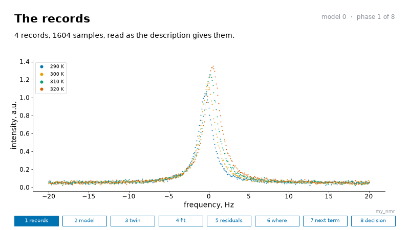

*The four spectra of the project, one for each temperature, as its description reads them.*

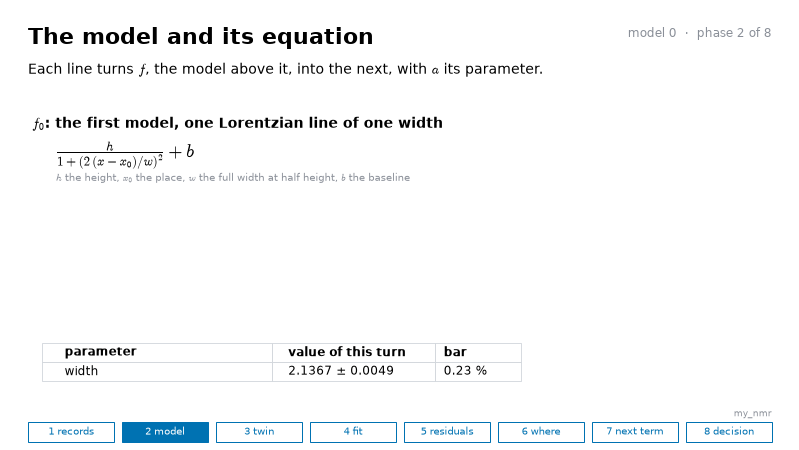

*The equation of the first model, one Lorentzian line of one width for all four spectra.*

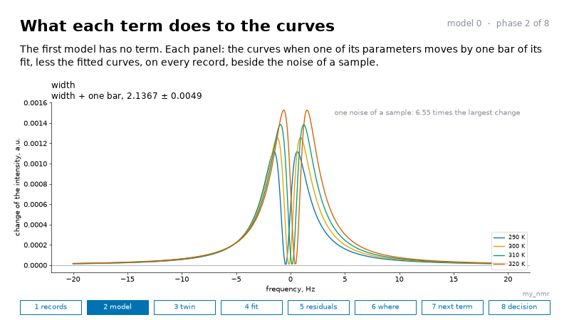

*What each term of the first model does to the curves.*

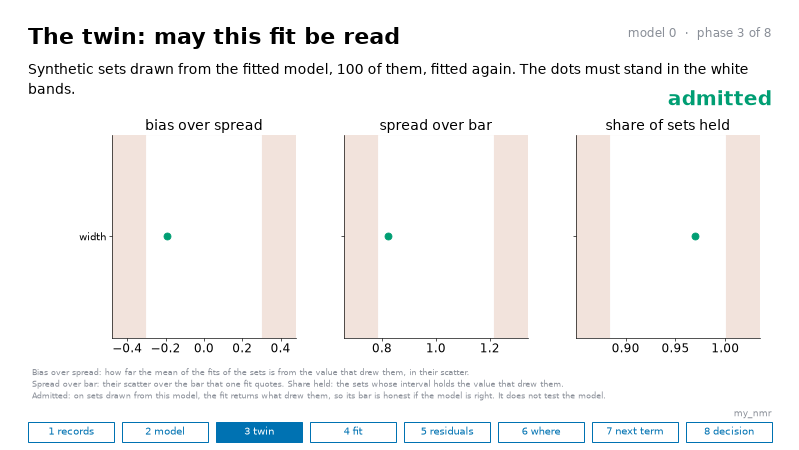

*On synthetic sets drawn from its fit, the first model returns what drew them: the twin admits it.*


*The joint fit of the four spectra by the first model.*

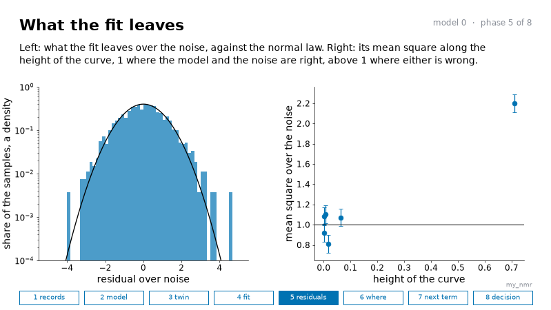

*What the first model leaves exceeds the noise at the top of the lines.*

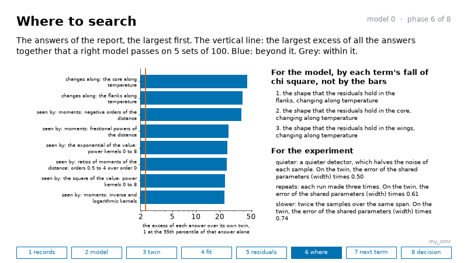

*The answers beyond the twin, the core and the flanks changing along the temperature first.*

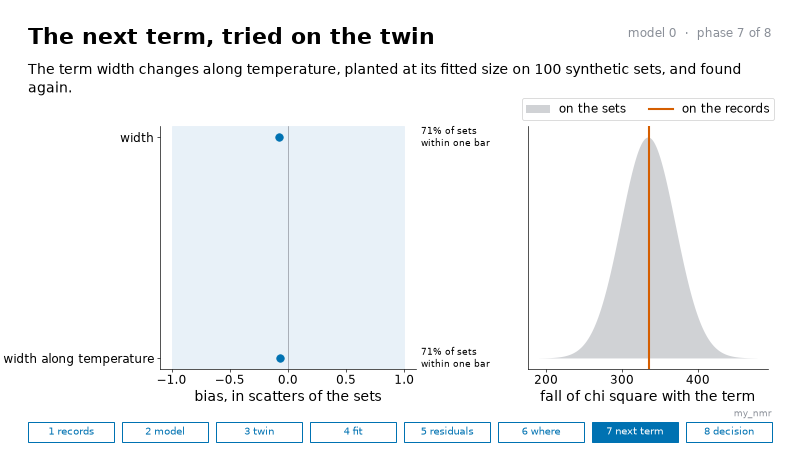

*The width along the temperature, planted on the twin and found again: its fall of chi square on the records lies within the twin's.*

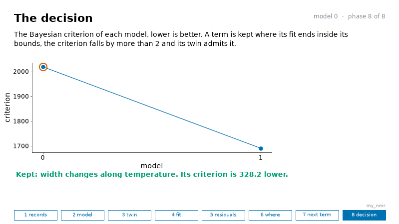

*The width along the temperature lowers the criterion and is kept.*

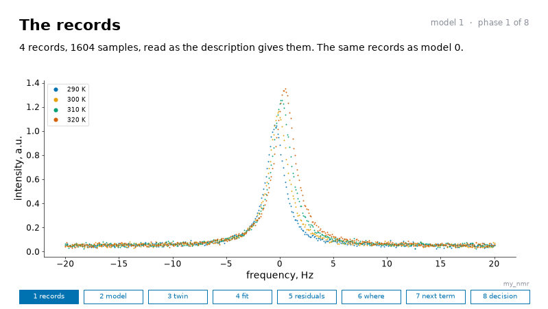

*The same four spectra, read by model 1.*

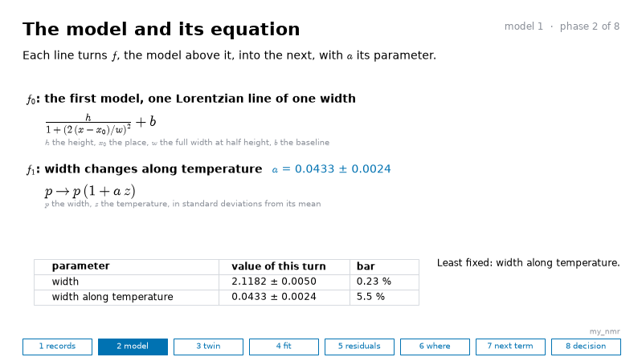

*The equation of model 1, the width of the first model times one plus a times z.*

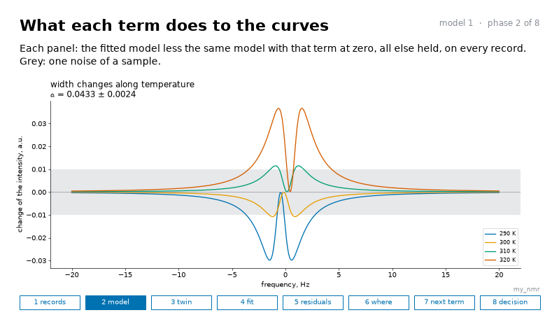

*What the new term does: the curves wider on the hot records and narrower on the cold ones.*

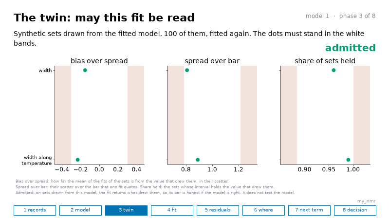

*The twin admits model 1, as a term is kept only where it does.*

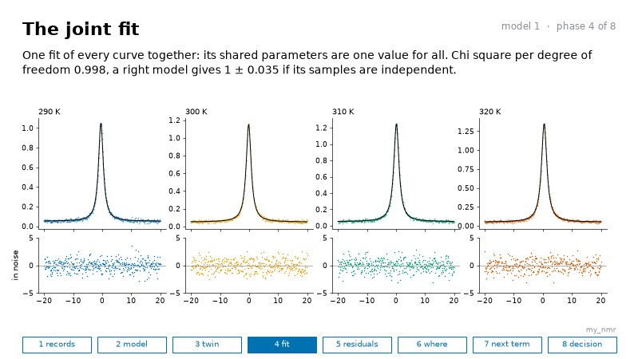

*The joint fit of the four spectra by model 1.*

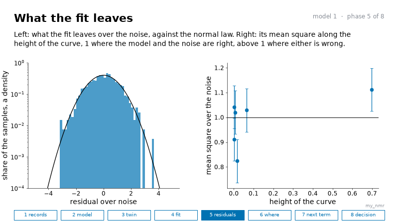

*What model 1 leaves, against the noise.*

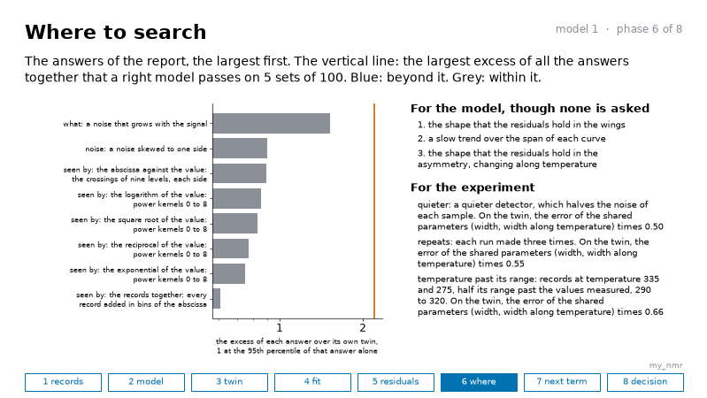

*No answer stands beyond the twin after model 1, so no term is asked.*

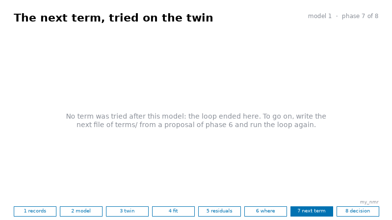

*No term is tried after model 1, and the loop ends.*

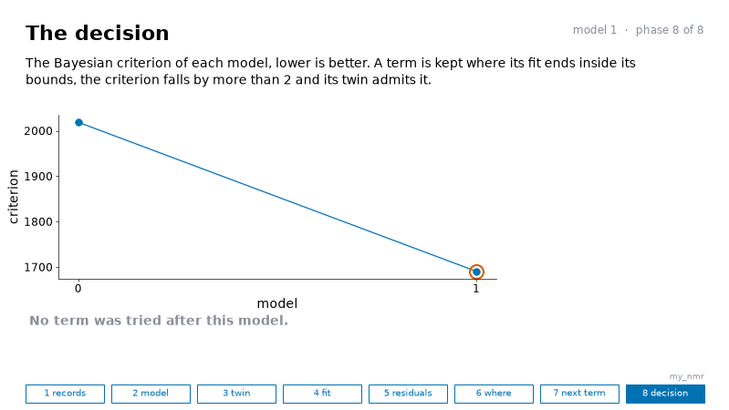

*Model 1 holds the lowest criterion of the run.*

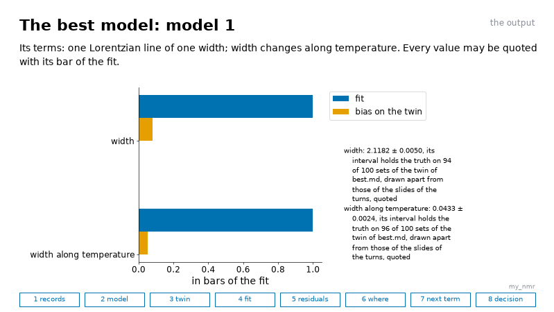

*The best model, model 1, each value with its bar of the fit and its bias on the twin.*

## 7. A term not asked for by the records

The loop is not a machine that keeps whatever it is given. Here is a term that no answer of the report points to, a ripple along the abscissa:

`my_nmr/terms/02.py`:

```python
from twinfit import mechanisms
term = mechanisms.periodic(3.0, "cosine")
why = "a test: no answer of the report points to a periodic function"
```

```bash
python -m twinfit loop my_nmr
```

```
model 0: the first model is fitted, and its twin and its report are read on 30 synthetic sets
01.py: width changes along temperature is fitted, and read on 30 synthetic sets: each term costs more than the one before it, since the model grows
02.py: a cosine of period 3 is fitted, and read on 30 synthetic sets: each term costs more than the one before it, since the model grows
best.md: the five parts of each value of the best model, on 30 synthetic sets
kept: 01.py, width changes along temperature. Refused: 02.py, a cosine of period 3. The best model: model 1. best.md gives the reason of each refusal.
The report of each model and the output are in my_nmr/loop. No answer of where, shape, what or changes along in the last report, nor a term of your list, stands beyond its twin: the records ask for no more, and a further term rests on theory alone. An own value moves from curve to curve, which no question of the report reads: best.md says which, and how to write it.
The visual log: my_nmr/loop/log.pdf, 19 slides, one for each phase of each of 2 turns with the equation of each model and what each term does, the pictures in my_nmr/loop/log and their list in my_nmr/loop/log.md.
```

It refused the ripple, and says why in `best.md`:

`my_nmr/loop/best.md`:

```markdown
Tried and refused:
- a cosine of period 3, in 02.py: the Bayesian criterion rises by 7.20 with it, where it must fall by more than 2: these records do not tell the model with it from the model without it. Its size, fitted: 0.00015 ± 0.00036. Fitted alone in the place of 01.py, its criterion is 334.78 higher than that of the model with 01.py

A term refused after others were kept may be refused because a kept term stands in its place. To try it alone, copy this folder, keep in the copy's terms/ only that file, renamed 01.py, and run the loop on the copy. To take a kept term out, copy the folder, leave out its file and rename those after it so that the numbers run on.
```

A term is kept when three things hold: its fit ends inside its bounds, the Bayesian criterion falls by more than 2, and the twin admits the model with it. The loop asks for no next term where no proposal beyond the twin gains, at first order, what a term of one parameter costs to be kept: 2 and the logarithm of the number of samples.

A refusal by the twin, or for too few of its searches that ended, read on the 30 synthetic sets of the default, can turn on more: `best.md` says so beside each, and `--sets 100` reads it again before the term is set aside, since a right term was refused on 30 sets and kept on 100.

Kept means that the records are better told with it than without it, and not that it is the term of the physics: on a model that lacks another term, a term of another shape can be kept, since it takes part of that misfit. Its reason, in `why`, is what makes it a term of physics. Such a term can move a shared parameter away from its truth: while the last report still has an answer beyond its twin, `best.md` says that no value is to be quoted yet.

To take a kept term out, copy the folder, leave out its file in the copy and rename those after it so that the numbers run on, and run the loop on the copy. A term refused behind a wrong one is tried alone the same way, in a copy whose `terms/` holds only it, as `01.py`.

## 8. The proposals for the experiment

Each report ends with three proposals for the experiment, each of one of three kinds: a better setup, a better characterization of the setup, or a better data collection.

Each comes from the description, which may name the changes that you could make, each a lever `[addenda.lever.NAME]` of one kind: noise, samples, span or repeats with a factor, covariate with new values of a setting, or characterization with an ansatz that it measures better. Every lever is measured, and those that do not rank among the three are said below them.

Where the description names fewer than three, the package adds changes that every experiment has: a quieter setup, more samples, more repeats, a wider span. It draws two more from the description itself: for each setting along which the curves vary and that no lever names, curves half its range past the values measured, and for each item of the setup known only as assumed or not recorded, its measurement. Each is measured on the twin: the twin is drawn again as the change would give it, and fitted, and the error of the known parameters, the shared ones of the model, is set against their error under the records as they are:

`my_nmr/loop/model_1.md`:

```markdown
## Three proposals for the experiment

Each is of one of three kinds: a better setup, a better characterization of the setup, or a better data collection. Each is measured on the twin, with the model as it is, since no proposal for the model stands beyond the twin. The error of a value is the root of its squared bias and its squared scatter there, over the same under the records as they are: under 1, the change helps.

- A better setup, quieter: a quieter detector, which halves the noise of each sample. In the twin, the noise of every sample is multiplied by the factor. The error of the known parameters is 0.50 of that under the records
  - of each parameter, the number above being their geometric mean, the n-th root of the product of the n of them: width 0.50, width along temperature 0.50
- A better data collection, repeats: each run made three times. In the twin, each record is taken the factor times, each with its own noise. The error of the known parameters is 0.57 of that under the records, known within about 0.11 on 30 sets, since the change draws noise of its own
  - of each parameter, the number above being their geometric mean, the n-th root of the product of the n of them: width 0.61 ± 0.11, width along temperature 0.52 ± 0.10
- A better data collection, temperature past its range: records at temperature 335 and 275, half its range past the values measured, 290 to 320. In the twin, records are added at the new values of one covariate, each with the own parameters of the record nearest in that covariate. The error of the known parameters is 0.65 of that under the records, known within about 0.12 on 30 sets, since the change draws noise of its own
  - of each parameter, the number above being their geometric mean, the n-th root of the product of the n of them: width 0.81 ± 0.15, width along temperature 0.52 ± 0.10
- Also measured, not among the three, a better data collection, slower: twice the samples over the same span. The error is 0.75 of that under the records, known within about 0.14
- Also measured, not among the three, a better data collection, a wider span: each record spans one and a half times its span about its middle, with the same step. The error is 1.16 of that under the records, known within about 0.21
```

## 9. The researcher's own curves

This writes the starting files of a project into a new folder:

```bash
python -m twinfit init my_project
```

```
written: my_project/description.toml
written: my_project/model.py
written: my_project/list_of_terms.py
written: my_project/CLAUDE.md
written: my_project/.claude/skills/twinfit/SKILL.md
made: traces/, terms/, agent/, for the curves, the term files and the record of an agent
the package is imported from /the/folder/that/holds/twinfit. It needs numpy and scipy, which /the/python/that/runs/it has. Fill description.toml and model.py, put the curves in traces/, then: python -m twinfit loop my_project
```

Its last line gives the folder of the package and the Python that runs it: here they are written as `/the/folder/that/holds/twinfit` and `/the/python/that/runs/it`, and on your machine they are the paths of yours. Fill the places marked `TO FILL` in the description: the loop refuses a description whose `name` or `what` still reads `TO FILL`, since every report quotes them. A description with no model under `[addenda]` starts from the generic model of the package, one peak or dip of one width on its own height, place and baseline, and says so. Here is the description to fill:

`my_project/description.toml`:

```toml
# The description of the data collection, which `python -m twinfit loop` reads. Fill the places marked `TO FILL`.

[problem]
name = "my problem"                      # `TO FILL`: a short name
what = "TO FILL: the physical problem in words: what was measured, how, and what the first model holds"
abscissa = "x"                           # `TO FILL`: the name of the abscissa of the curves, and its unit below
abscissa_unit = "s"                      # `TO FILL`: the unit of the abscissa
# abscissa_offset = 587.6                # optional: taken from the abscissa of every curve, where the curves sit far from zero against their span
value = "signal"                         # `TO FILL`: the name of what was measured, and its unit below
value_unit = "V"                         # `TO FILL`: the unit of the value, or "1" where it has none

[covariates.setting]                     # `TO FILL`: each setting under which a curve was taken, with its unit, one table each
unit = "none"                            # `TO FILL`

[[trace]]                                # `TO FILL`: one table a curve: its file in traces/, its two columns, its settings
file = "traces/one.csv"
columns = ["x", "signal"]
setting = 1

[noise]                                  # the standard deviation of the noise of each sample, given in one of five ways:
from = "neighbours"                      # "neighbours", the default where [noise] is left out: a law in the height of the curve above its foot, a + b h + c h^2, read from the second differences of neighboring samples before any fit
                                         # "residuals": the same law, read from what the first model leaves, for a curve sharper than three samples, whose second differences hold the curve
                                         # "value", with a line value = 0.01: one number for every sample, in the unit of the value, where you know it
                                         # "column", with a line column = "sd": a third column of each file
                                         # "model": a law of yours, a function variance(mean, record, own) in model.py that gives the variance of each sample

# [setup.detector]                       # optional, one table each: an instrument or a setting of the data collection, in words, with its value,
# words = "the gain of the detector"     # its uncertainty and its unit where they are known, and how it is known: "measured", "set", "from its
# value = 1e6                            # maker", "assumed" or "not recorded". The package reads no physics in it: whoever chooses the terms
# unit = "V/A"                           # starts from it, and a lever of kind "setup" names one of them
# known = "set"

[addenda]                                # all optional: with no model the loop starts from the package's generic model
model = "model.py"                       # the first model
list_of_terms = "list_of_terms.py"       # optional: the terms that you suspect, which the report sets against the residuals. Empty at the start

[addenda.lever.quieter]                  # optional: a change of the experiment, which the three proposals for the experiment weigh against the others
kind = "noise"
factor = 0.5
words = "a quieter detector, which halves the noise of each sample"
```

Write your first model in `model.py`, from this start, and its `EQUATION`, the model in LaTeX between dollar signs: the visual log typesets it at each turn, and shows the Python line of `model` where it is left empty:

`my_project/model.py`:

```python
"""The first model of this project, which `python -m twinfit loop` reads. Fill the places marked TO FILL.

Start with the small model that is understood in every part. The loop fits it to every curve at once, reads what it
leaves against its twin, and says where a term is missing: each term that you then write in terms/ is fitted beside it.
"""
import numpy as np

SHARED = ("width",)                     # TO FILL: the parameters that every curve shares, which the analysis is after
OWN = ("height", "place", "baseline")   # TO FILL: the parameters of each curve alone
START_SHARED = [1.0]                    # TO FILL: a start for each shared parameter, in the order of SHARED
BOUNDS_SHARED = ([1e-9], [1e6])         # optional: the lower bounds and the upper bounds of the shared parameters, a width above zero since a curve divides by it
CENTRE = "place"                        # an own parameter, which `centre` below goes with: the report reads the core and the wings of a curve about the place that `centre` returns. Where the place is shared, as one that a setting moves, name any own parameter here, as the height, and let `centre` return the place from `shared`
NAME = "one peak of one width"          # TO FILL: the model in a few words, as the report names it
EQUATION = ""                           # the model in LaTeX between dollar signs, as r"$h\,e^{-(x - x_0)^2/(2 w^2)} + b$", which the visual log typesets at each turn, `python -m twinfit log`. Left empty, the log writes the Python line that `model` returns
LETTERS = {}                            # each letter of EQUATION with its meaning, as {"h": "the height", "x_0": "the place", "w": "the width", "b": "the baseline"}, which the log writes under it


def model(x, shared, own, design):
    """TO FILL: the mean of one curve. `x` is its abscissa, `shared` and `own` hold the parameters in the order of
    SHARED and OWN, and `design` the settings of the curve, as the description gives them."""
    return own[0] * np.exp(-0.5 * ((x - own[1]) / shared[0]) ** 2) + own[2]


def start_own(record):
    """TO FILL: a start for the own parameters of one curve, read from its values, in the order of OWN. This one reads a
    peak or a dip on a baseline that may slope: the baseline as a straight line through the means of the first and the
    last twentieth of the curve, the place as the first sample from the left whose distance from that line reaches four
    fifths of the largest, that distance as the height, negative for a dip, and the line there as the baseline. So every
    curve of a doublet starts on its lower line, and a dip on a slope is not taken for an end of the slope, where the
    median as a baseline took the end of a slope as steep as the dip. A curve started away
    from its peak or its dip is moved by no shared parameter, and the first fit is then refused."""
    order = np.argsort(record.x)
    x, y = np.asarray(record.x, dtype=float)[order], np.asarray(record.y, dtype=float)[order]
    n = max(len(y) // 20, 1)
    left, right = float(np.mean(y[:n])), float(np.mean(y[-n:]))
    line = left + (right - left) * (x - x[0]) / ((x[-1] - x[0]) or 1.0)
    up = np.abs(y - line)
    top = int(np.flatnonzero(up >= 0.8 * up.max())[0])
    return [float(y[top] - line[top]), float(x[top]), float(line[top])]


def start_shared(records):
    """optional, and where it is defined it takes the place of START_SHARED: a start for each shared parameter, read
    from the curves. This one reads the width of the peak or the dip of each curve where its distance from the straight
    line through its ends is half the largest, and gives their mean as a standard deviation. Change it or remove it when
    SHARED changes."""
    widths = []
    for record in records:
        order = np.argsort(record.x)
        x, y = np.asarray(record.x, dtype=float)[order], np.asarray(record.y, dtype=float)[order]
        n = max(len(y) // 20, 1)
        left, right = float(np.mean(y[:n])), float(np.mean(y[-n:]))
        line = left + (right - left) * (x - x[0]) / ((x[-1] - x[0]) or 1.0)
        up = np.abs(y - line)
        above = x[up >= 0.5 * up.max()] if up.max() > 0 else x
        widths.append((above.max() - above.min()) / 2.3548 if above.size > 1 and above.max() > above.min() else float(np.ptp(x)) / 10.0)
    return [float(np.mean(widths))]


def centre(shared, own, design):
    return own[1]
```

Put each curve in `traces/`, one file a curve: a first line that names the columns as `columns` names them, then one line a sample, the abscissa and the value separated by a comma, with no line of comments, as in section 3.

**The noise of each sample**, in four steps:

1. Where you know the noise of a sample, give it, `from = "value"` with its standard deviation, or `from = "column"` with a column of each file.
2. Where you do not know it, leave `[noise]` out, or write `from = "neighbours"`, the default: the package reads the variance of the noise as a law in the height of the curve above its foot, a + b h + c h^2, a floor, a counter and a noise in proportion to the signal, from the second differences of neighboring samples before any fit, which a curve smooth over three samples barely reaches.

   Where a curve is sharper than that, write `from = "residuals"`: the same law, read from the second differences of what the first model leaves, and the model is fitted again with it. Either way a missing term smooth over three samples is not read as noise, on a peak as on a decay.

3. A law of your own, as one from the instrument, goes in a column of each file: the residuals of each model are in `loop/residuals_K.csv`, whose columns are the curve, the abscissa, the value, the fitted value, the residual and the noise that each sample was given.
4. Make each change of the noise in a copy of the folder, made without its `loop/` and `agent/`, as `rsync -a --exclude loop --exclude loop.before --exclude loop.reuse --exclude agent --exclude .twinfit.lock --exclude .twinfit.command my_project/ my_copy/` makes it, run the loop on the copy, and quote the copy's `best.md`: the first folder keeps its run as the record of what the noise changed.

The report leads with a kind where that kind is the first answer of what beyond the twin and its excess passes that of every answer of the mean beyond the twin: a misfit of the mean far larger leaves part of itself in the reading of the noise, so there the term comes first, and the noise is read again once the mean holds.

Where it leads with a noise correlated from sample to sample, as a filter of the detector leaves it, its page gives the number of samples over which the correlation falls: keep one sample in every that many, in a copy of the folder, and run the loop on several such copies, each from another first sample, since a term that one keeps and the others refuse is not to be believed.

`python -m twinfit thin my_project N` writes up to three such copies beside the folder, fewer where N is small and two starts fall on one sample, each named `DIR_thin_N_S` with S the first sample that it keeps. Quote the values of one copy with the half range of the three beside them: its bars, about the root of N times those of the whole folder, are the ones to quote, since the whole folder counts each sample as apart.

Where the report leads with glitches, samples far from the curve in one record alone, the page of the model names them, and no term file holds them: in a copy of the folder, give them a larger noise in a column of the curves, `from = "column"`, or leave them out of the files, and run the loop on the copy. In the column, each such sample takes a noise as large as its residual, the whitened residual that the page gives times the noise of the description, so that it weighs as one sample of noise, and every other sample the noise of the description.

**Curves that are not peaks.** A decay that starts at a time, a step or an edge is read as a peak is. `centre` gives the place about which the report reads, as the start of a decay: the core is the part near it, the wings the parts far from it, and the asymmetry the difference of its two sides.

The width in the names of the proposals is the width of the fitted curve at half its height above its median value, the unit of their distances. The kinds are shapes of the residuals and not causes: a tail on the upper side of a decay can be a second, slower decay, which no term of the package writes, since `second` is a copy of the curve displaced along the abscissa. Write it in `model.py`, its share and its lifetime as shared parameters, as the component of section 10, and a law of a setting, as the lifetime 1/(1 + K Q) of a quencher Q, there too.

**The loop.** Then run the loop, `python -m twinfit loop my_project`, read the report, write a term, and run it again. A term file that was kept may be written again later: each run fits every file afresh. A value that you hold from theory or from another measurement enters as an ansatz, `[addenda.ansatz.NAME]` with a line `value` and a line `uncertainty`, `NAME` a setting of every curve or a key of a dictionary `HELD` that `model.py` reads: its uncertainty is then the bar of theory of each parameter that it moves.

**A model that grows.** Start from a model small enough that you understand every part of it. The report reads what that model lacks, and each term that you add is one answer. Four things are written in `model.py` or in the description, and not in a term file. Each is a change of the folder: make it in a copy, made without `loop/` and `agent/`, so that the run before it stays as its record, as the guide of an agent asks too:

1. A dependence that the physics already gives, as a width that grows with the power, can be written in `model.py` itself, a shared parameter that reads `design["power"]`: it needs no term file, and its value is quoted as it is written.
2. An own value that moves with a setting, as the place of a line that the temperature shifts, is read by no question of the report while it is own to each curve, and `best.md` names it with its slope: write it as shared parameters. Here the place of the line of section 3, written to move along the temperature:

```python
import numpy as np

SHARED = ("width", "place_at_300", "shift_per_kelvin")   # the place at 300 K, and its change for each kelvin
OWN = ("height", "baseline")                              # of each spectrum
START_SHARED = [2.0, 0.0, 0.0]
CENTRE = "height"                                         # a name and no more: `centre` below gives the place
NAME = "one Lorentzian line of one width, its place along the temperature"


def place(shared, design):
    return shared[1] + shared[2] * (design["temperature"] - 300.0)


def model(x, shared, own, design):
    return own[0] / (1.0 + (2.0 * (x - place(shared, design)) / shared[0]) ** 2) + own[1]


def start_own(record):
    return [float(record.y.max() - record.y.min()), float(np.median(record.y))]


def centre(shared, own, design):
    return place(shared, design)
```

This is the whole file: it takes the place of the `model.py` of section 3, whose `BOUNDS_SHARED` held one bound for its one shared parameter, and here holds none, since a bound is given for each shared parameter or for none, and a start for each, in `START_SHARED` or by a function `start_shared(records)` that reads them from the curves.

`CENTRE` names one of `OWN`, any one, since the package asks that it be one of them: here it is a name and no more, and `centre` returns the place from the shared parameters, so that the report reads the core and the wings about it, and a pedestal or a periodic term, placed about it, can still be fitted. On the spectra of section 3 this model gives the width that the model of own places gives, and the shift for each kelvin with its bar.

3. A setting taken in the order of the time cannot be told from a drift of the instrument: write the order under `[problem]` as `order = "..."`, and `best.md` says it beside the values.
4. Where the curves sit far from zero against their span, the span from the least abscissa of the curves to the largest, their middle more than three spans from zero, as lines near 587.6 nm a few hundredths of a nanometer wide, write `abscissa_offset = 587.6` under `[problem]`, and a refusal of the loop names the value: the abscissa is read less it everywhere, in `model.py`, in `start_own`, in the term files, in every place that the output gives and in `residuals_K.csv`, since the fit moves the place of a curve by steps that grow with the size of the place.

   So the starts and the bounds of a place, in `START_SHARED` and `BOUNDS_SHARED`, are written less it too, and `best.md` gives each place less it too, with a line that says so: add the offset back to quote a place.

The keys of the description beyond those of section 3, each with its form. The noise of each sample is given one of five ways. The output is for people, for agents or both, and the search of the literature is none, local, online or both, run by an agent of the model and the `effort` given.

An ansatz is a value held before the fit, with its uncertainty. A lever is a change of the experiment that the proposals weigh: `noise`, `samples`, `span` or `repeats` with a factor, `covariate` with the setting and its new values, `characterization` with the ansatz that it measures better and a factor on its uncertainty, or `setup` with `of`, the name of an item of `[setup]` that it changes, and a factor, a half where none is given. A lever of kind noise or setup is proposed as a better setup, one of kind characterization as a better characterization of the setup, and the other four as a better data collection:

```toml
[noise]                          # one of five ways
from = "value"                   # one standard deviation for every sample
value = 0.02
# from = "column"                # or a column of the curves that gives the standard deviation of each sample
# column = "sd"
# from = "neighbours"            # or the default, a law in the height of the curve, read from the differences of neighboring samples before any fit
# from = "residuals"             # or the same law, read from what the first model leaves, for a curve sharper than three samples
# from = "model"                 # or a law of yours: variance(mean, record, own) in model.py, the variance of each sample

[output]                         # who reads the output of the loop: both by default
for = ["people", "agents"]       # people: the visual log and model_K.md, agents: brief_K.md, one page a model

[literature]                     # a search of the literature by an agent, which `python -m twinfit literature DIR` briefs
search = "none"                  # none, local, online or both
folder = "papers"                # the papers held, for a local search
model = "sonnet"                 # the model of the agent that searches, and its effort
effort = "high"

[addenda.ansatz.resolution]      # a key of the dictionary HELD of model.py, or a setting that every curve gives at this value
value = 0.5
uncertainty = 0.05

[addenda.lever.quieter]          # noise, samples, span or repeats: with a factor
kind = "noise"
factor = 0.5
words = "a detector of half the noise"

[addenda.lever.hotter]           # covariate: new values of one setting
kind = "covariate"
covariate = "temperature"
values = [330.0, 340.0]
words = "two spectra at higher temperatures"

[addenda.lever.resolution]       # characterization: an ansatz measured better, its uncertainty times the factor
kind = "characterization"
of = "resolution"
factor = 0.5
words = "the resolution measured before the run"
```

An ansatz on a setting holds it at one value, which every curve gives: a setting that changes from curve to curve is fitted along, and not held. An ansatz on a key of `HELD` sets that key before each fit, and `model.py` reads it where it computes the curve:

```python
HELD = {"resolution": 0.5}          # the values that the model reads and does not fit, which an ansatz sets


def model(x, shared, own, design):
    width = (shared[0] ** 2 + HELD["resolution"] ** 2) ** 0.5
    return own[0] / (1.0 + ((x - own[1]) / width) ** 2) + own[2]
```

Its uncertainty is then the bar of theory of each parameter that it moves, and a lever of kind characterization of it says what measuring it better would buy. A number written in a term file, as the distance of a second component, is held by nothing: where a measurement could fix it, move it into `model.py` as a key of `HELD`, with its ansatz.

## 10. A term of unknown distance or period

Some terms carry a number that is chosen and not fitted: the distance of a second component, the stretch of a tail, the period of a ripple. The worked project of chromatography has one:

```bash
python -m twinfit example chromatography my_chrom
```

```
written into my_chrom: description.toml, model.py, an empty terms/, and 4 curves in traces/. Next: python -m twinfit loop my_chrom
```

```bash
python -m twinfit loop my_chrom
```

```
model 0: the first model is fitted, and its twin and its report are read on 30 synthetic sets
best.md: the five parts of each value of the best model, on 30 synthetic sets
kept: nothing. Refused: nothing. The best model: model 0.
The report of each model and the output are in my_chrom/loop. Write my_chrom/terms/01.py with the next term, then run the loop again. An own value moves from curve to curve, which no question of the report reads: best.md says which, and how to write it.
The visual log: my_chrom/loop/log.pdf, 10 slides, one for each phase of each of 1 turn with the equation of each model and what each term does, the pictures in my_chrom/loop/log and their list in my_chrom/loop/log.md.
```

The report puts the misfit of the chromatograms in their asymmetry:

`my_chrom/loop/model_0.md`:

```markdown
## Where to search

Read on 30 synthetic sets. The first answer beyond the twin of each question, beyond meaning an excess above 3.02 here:

| question | what it asks | first answer beyond the twin | its excess |
|---|---|---|---|
| where | the core of the curves, their flanks, their wings or their asymmetry | the asymmetry | 7.4 |
| shape | how the residuals are shaped: a slow trend over the span of each curve, or a periodic structure | none beyond the twin. The largest: a periodic structure along the abscissa | 0.3 |
| what | glitches, a noise that grows with the signal, or a noise correlated from sample to sample | none beyond the twin. The largest: a noise that grows with the signal | 0.9 |
| changes along | which part of the residuals changes from curve to curve along a setting, read on the residuals themselves | none beyond the twin. The largest: the asymmetry along temperature | 1.3 |
| seen by | the family of statistics that sees the misfit most | moments: cosines and sines | 3.7 |
| noise | the shape of the noise: skewed to one side, or with heavy tails | none beyond the twin. The largest: a noise skewed to one side | 0.2 |
```

The chi square of this first model, 1253.0 on 1191 degrees of freedom, agrees with the noise, and the report finds the second component all the same: a term that holds a small part of the curve moves the whole chi square by less than its own scatter, while a statistic aimed at one shape reads it. That is what the report is for.

In a chromatogram an asymmetry of the peaks is a compound that elutes close to the first, an impurity, or a tail of the column. The first proposal for the model is the asymmetry, measured with the shape that the residuals hold there:

`my_chrom/loop/model_0.md`:

```markdown
## Three proposals for the model

Each is a direction read on the residuals, for an answer of where, of shape or of what changes along a setting: those beyond the twin first, then by the gain in chi square that the shape that the residuals hold there brings when it is fitted beside the model. The package names no term: which term of physical origin has that place, shape and setting is the researcher's to say, in a term file. On its twin, synthetic curves drawn with the term at its fitted size are fitted without it and with it: the bias without it is what the term would cost the known parameters if it were real, and says nothing of whether it is.

In the names of the proposals a width is the full width of the fitted curves at half their height above their median value, here 2.4 in the unit of the abscissa: where the wings of a curve fill its window, it is narrower than the width at half its peak, and it is not a parameter of the model. Above the centre is toward larger abscissa.

- the shape that the residuals hold in the asymmetry, for the asymmetry, beyond the twin at an excess of 7.4: a gain in chi square of 283.8
  - if the term were real at that size, width would be biased on its twin by 0.3 scatters, 0.00109 in its own unit, without it and by 0.2 scatters, 0.000713 in its own unit, with it: what the term would cost, and not a sign that it is real. A scatter of a model that lacks a term can be many bars of its fit. This shape is read on the residuals, which hold none of what the fit took into its own parameters, so this cost is a lower bound: a term of the physics in this place may cost far more
- the shape that the residuals hold in the flanks, for the flanks, within the twin at an excess of 1.0: a gain in chi square of 132.2
  - if the term were real at that size, width would be biased on its twin by 0.3 scatters, 0.000963 in its own unit, without it and by 0.2 scatters, 0.00072 in its own unit, with it: what the term would cost, and not a sign that it is real. A scatter of a model that lacks a term can be many bars of its fit. This shape is read on the residuals, which hold none of what the fit took into its own parameters, so this cost is a lower bound: a term of the physics in this place may cost far more
- the shape that the residuals hold in the asymmetry, changing along temperature, for the residuals in the asymmetry change along temperature, within the twin at an excess of 1.3: a gain in chi square of 11.6
  - if the term were real at that size, width would be biased on its twin by 0.2 scatters, 0.00065 in its own unit, without it and by 0.2 scatters, 0.000713 in its own unit, with it: what the term would cost, and not a sign that it is real. A scatter of a model that lacks a term can be many bars of its fit. This shape is read on the residuals, which hold none of what the fit took into its own parameters, so this cost is a lower bound: a term of the physics in this place may cost far more

The asymmetry leads. Where no proposal above holds it once fitted, a shape that no term of the package writes may be missing, asymmetric about the place of the line: an exponential fall of the line on one side, its height times x over one plus x squared, x the distance from its place in its widths, or the derivative of the line. A Mechanism of your own writes it, as section 11 of the tutorial shows, and the physics of the records says which.
```

Try the impurity first, a second component of the curve, `second(distance)`, with its distance in the unit of the abscissa. In the page of the proposals a width is the full width of the fitted curves at half their height above their median value, 2.4 s here, while the parameter `width` of this model is the standard deviation of its Gaussian, 1 s. The distance is not read off the report, which names no term.

`scan` fits the term at each distance that you give, beside the model, and says which lowers the Bayesian criterion most. The distances are in the unit of the abscissa, here seconds, and `x` stands for the number that is scanned: `"second(x)"` is `second(distance)` at each value given. It chooses the stretch of `tail` or the period of `periodic` the same way, with the other argument in quotes, `"tail(x, 'upper')"` or `"periodic(x, 'sine')"`.

It refuses the term at a number that a kept term file of the folder already holds, and fits a second term of the same kind beside it at any other number: the files that the loop refused are not in the model that it scans beside. To scan the number of a term that a file holds, scan in a copy of the folder without that file.

Where the range that it gives is under the step of the values scanned, a parabola through the three falls about the largest gives it, and the top of that parabola is the value to write. That range is the bar of the chosen number where the noise is white: under a noise correlated over N samples it is about the root of N too narrow, so read it after the noise is thinned.

A distance has a side, and a term on the wrong side can still lower the criterion with a negative size, which takes its shape away from the curve: scan both signs, as -2 -1 1 2, keep the side of the larger fall and of a positive size, and read a kept term of negative size as the command line and `best.md` flag it. `displaced` points the other way: its long side is toward smaller abscissa where its reach is positive, as `python -m twinfit terms` says.

```bash
python -m twinfit scan my_chrom "second(x)" 0.6 0.8 1 1.2 1.4 1.6 1.8 2 2.4
```

```
second(x) beside the model of my_chrom, its first model, at each x, in the unit that the term takes: a distance or a period in the unit of the abscissa, a stretch or a power as a number. The fall of the Bayesian criterion is from the model without the term, the size is that of the term and the bar its bar of the fit. No twin is run here: the loop decides.
| x | its fit | fall of the Bayesian criterion, negative where it rises | size | bar |
|---|---|---|---|---|
| 0.6 | did not end | -7.1 | 0.000 | 0.074 |
| 0.8 | did not end | 27.1 | 0.25 | 0.18 |
| 1 | ended | 38.4 | 0.158 | 0.038 |
| 1.2 | ended | 41.5 | 0.089 | 0.015 |
| 1.4 | ended | 42.3 | 0.0577 | 0.0087 |
| 1.6 | ended | 42.0 | 0.0414 | 0.0060 |
| 1.8 | ended | 41.0 | 0.0318 | 0.0046 |
| 2 | ended | 39.2 | 0.0256 | 0.0037 |
| 2.4 | ended | 34.2 | 0.0183 | 0.0028 |
The largest fall: at x = 1.4. The values of x whose fall is within 1 of it, which is one standard deviation of x as the profile gives it, the criterion of the best fit at each x, if the model is otherwise right: 1.20 to 1.60. Where the range is wide, these records fix the size and x together and not each. To try it, write `term = mechanisms.second(1.4)` in the next term file, then run the loop.
Across that range the other values of the model move: width from 0.9884 to 1.0029. Half of each move is the part of its uncertainty that the chosen x carries: quote it beside the five parts of best.md.
```

At 0.6 and 0.8 s, the nearest distances, the second component lies so close to the peak that the fit cannot tell its size from the shape of the peak, and its search does not end. A fit that does not end is no answer, and the scan reads the others.

The distances from 1.2 to 1.6 s lower the criterion within 1 of the largest: the records do not tell them apart by the criterion, and the loop, with its twin, decides. Write the term at the distance that the scan gives, and run the loop:

`my_chrom/terms/01.py`:

```python
from twinfit import mechanisms
term = mechanisms.second(1.4)
why = "the report: a second component in the asymmetry. An impurity that elutes later, at the distance that the scan gives"
```

```bash
python -m twinfit loop my_chrom
```

```
model 0: the first model is fitted, and its twin and its report are read on 30 synthetic sets
01.py: a second component 1.4 away is fitted, and read on 30 synthetic sets: each term costs more than the one before it, since the model grows
best.md: the five parts of each value of the best model, on 30 synthetic sets
kept: 01.py, a second component 1.4 away. Refused: nothing. The best model: model 1.
The report of each model and the output are in my_chrom/loop. No answer of where, shape, what or changes along in the last report, nor a term of your list, stands beyond its twin: the records ask for no more, and a further term rests on theory alone. An own value moves from curve to curve, which no question of the report reads: best.md says which, and how to write it.
The visual log: my_chrom/loop/log.pdf, 19 slides, one for each phase of each of 2 turns with the equation of each model and what each term does, the pictures in my_chrom/loop/log and their list in my_chrom/loop/log.md.
```

The curves were drawn with an impurity 1.4 s after the peak, of 0.06 of its height. The scan gives the distance from 1.2 to 1.6 s, and 1.4 s is in that range. The size moves with the distance across it, from 0.089 at 1.2 s to 0.041 at 1.6 s: these records fix the distance and the size together and not each.

At 1.4 s the loop kept the term with a size of 0.0577 ± 0.0087, and the width of the peak, 0.9967 ± 0.0058 s with the term, was 1.031 s without it, where 1 s drew the curves. The width moves across the range of the distance too, as the last line of the scan says: half of its move is a part of its uncertainty that no column of `best.md` holds, since the distance is written and not fitted, and it is quoted beside them.

A measurement of the retention time of the impurity alone, a better characterization of the setup, would fix the distance, and the size and the width with it.

To carry the distance into the uncertainty of every other value, hold it: a key of `HELD` in `model.py`, an ansatz with half the range that the scan gives as its uncertainty, and a term that reads it at each call. That range comes from these records, so this ansatz narrows nothing: it carries the uncertainty of a chosen number into the other values, where an ansatz that narrows a value must come from outside the records.

A term of the package takes its number when its file is read, so `held.reading` builds it again at each call, from the value that `HELD` holds then. The new `01.py` takes the place of the one above, and it reads `HELD` by its name with no import: the loop gives every term file the names of `model.py`, its functions and its constants as well as `HELD`, so that a term reads them with no import:

`my_chrom/model.py`, at its end:

```python
HELD = {"distance": 1.4}          # the distance of the impurity, held by the ansatz of the description
```

`my_chrom/description.toml`, at its end:

```toml
[addenda.ansatz.distance]
value = 1.4
uncertainty = 0.2
```

`my_chrom/terms/01.py`:

```python
from twinfit import held, mechanisms
term = held.reading(lambda: mechanisms.second(HELD["distance"]))
why = "the report: a second component in the asymmetry, at the distance that the scan gives and that the ansatz holds"
```

```bash
python -m twinfit loop my_chrom
```

```
model 0: the first model is fitted, and its twin and its report are read on 30 synthetic sets
01.py: a second component 1.4 away is fitted, and read on 30 synthetic sets: each term costs more than the one before it, since the model grows
best.md: the five parts of each value of the best model, on 30 synthetic sets
kept: 01.py, a second component 1.4 away. Refused: nothing. The best model: model 1.
The report of each model and the output are in my_chrom/loop. No answer of where, shape, what or changes along in the last report, nor a term of your list, stands beyond its twin: the records ask for no more, and a further term rests on theory alone. An own value moves from curve to curve, which no question of the report reads: best.md says which, and how to write it.
The visual log: my_chrom/loop/log.pdf, 19 slides, one for each phase of each of 2 turns with the equation of each model and what each term does, the pictures in my_chrom/loop/log and their list in my_chrom/loop/log.md.
```

`my_chrom/loop/best.md`:

```markdown
## To quote

Each parameter as a value with the bar of the fit, then, as separate terms, the bar of theory and the half range over the models where they are not zero. Where one bar is asked, add them in squares, since each comes from another source. The bias on the twin is not taken out while it is under one bar. Where the noise, the coverage or the bias fails, the line says so.

- width: 0.9967 ± 0.0058 of the fit ± 0.0073 of theory
- second component at 1.4: 0.0577 ± 0.0087 of the fit ± 0.024 of theory
- height, place, baseline, of each curve: Each is in the section of the parameters of each curve with its bar of the fit, which counts what the shared parameters leave uncertain. The twin reads no coverage and no bias of them: quote each with its bar of the fit alone, and with the settings of its curve

## Notes

- The bias on the twin here is in bars of the fit, on sets of its own: the report of each model reads it in spreads of the estimate, on other sets, so the two differ.
- The coverage on the twin here is read on sets of its own too, and a coverage counted on 30 sets scatters by about 0.04 from one draw of the sets to another: the coverage of a parameter in the report of its model can differ from this one by two or three times that, with no fault in either.
- The spread over the models reads the models of this folder alone. A form of a term tried in a copy, as a law of the physics in `model.py` in the place of a term of the package, is not in it: compare such forms by their Bayesian criterion and quote the range of their values beside the five parts.
- second component at 1.4: the number in its name is chosen and not fitted, so it has no bar of the fit, where the row above gives the size of the term and its bar: quote that number with the range that `python -m twinfit scan` gives about it, and hold it with an ansatz of half that range where its uncertainty is to reach the other values, or write it in `model.py` as a shared parameter, which the fit then gives a bar and the twin a coverage. The size of a second component is its area over that of the curve, and the place stays that of the first line, so the middle of a doublet is the place plus half its distance.
- second component at 1.4: its size holds at the number written in its term file, or in `HELD` of the model where the term reads it there, a distance, a stretch or a period. `python -m twinfit scan` says how far the records fix that number, and the size moves with it.

## The parameters of each curve

Each with its bar of the fit, which counts what the shared parameters leave uncertain: the twin reads the shared ones alone. An own value that moves with a setting is a term of its own: read them down each column.

- height moves with temperature: a line through its values gives 0.01013 ± 0.00027 per unit of temperature, 37 bars from none, a chi square of 0.8 on 2 about the line. While height is own to each curve, no question of the report reads it: write it in `model.py` as shared parameters that read `design["temperature"]`, as section 9 of the tutorial shows, and the report reads what is left. Across 4 curves a line can also hold by chance, so ask whether the physics gives it.
- place moves with temperature: a line through its values gives 0.03016 ± 0.00042 per unit of temperature, 71 bars from none, a chi square of 0.4 on 2 about the line. While place is own to each curve, no question of the report reads it: write it in `model.py` as shared parameters that read `design["temperature"]`, as section 9 of the tutorial shows, and the report reads what is left. Across 4 curves a line can also hold by chance, so ask whether the physics gives it.

| curve | temperature | height | place | baseline |
|---|---|---|---|---|
| traces/temperature_30.csv | 30 | 1.0053 ± 0.0058 | 11.5507 ± 0.0100 | 0.0505 ± 0.0012 |
| traces/temperature_40.csv | 40 | 1.1001 ± 0.0059 | 11.8443 ± 0.0096 | 0.0508 ± 0.0012 |
| traces/temperature_50.csv | 50 | 1.2084 ± 0.0061 | 12.1496 ± 0.0092 | 0.0509 ± 0.0012 |
| traces/temperature_60.csv | 60 | 1.3071 ± 0.0063 | 12.4537 ± 0.0090 | 0.0492 ± 0.0012 |

Tried and refused: none.

The loop stops here: no answer of where, what or along stands beyond the twin, so the records ask for no more term. A term that the physics asks for is held at its value of theory, in terms/02.py, with hold = True.
```

The bar of theory of each value is now the move that the distance makes across its uncertainty, and it is quoted beside the bar of the fit. The column says of theory whatever the source of the ansatz: here it is the range of a number that these records chose.

Where the records fix the distance well, as the coupling of a doublet whose two lines stand apart, a third way gives it a bar of its own: write the second line in `model.py`, with the distance as a shared parameter, and the fit gives the distance its bar and the twin its coverage, as every other shared value.

The term `second` places its copy from the place of the curve, so the place stays that of the first line: the middle of an equal doublet is the place plus half the distance, and the report reads the core and the wings about the first line. The size of a second component, a pedestal or a tail is its area over that of the curve, and never a distance.

Where the curves are doublets, start every curve on the same line: the `start_own` of the template takes the first sample from the left that reaches four fifths of the largest distance from the baseline, so that each curve starts on its lower line, and a page whose places differ by more than a width while the fit leaves much says that the starts may sit on different lines.

A component of its own width at its own distance, as the outflow under the emission line of a galaxy, is no term of the package, which adds one parameter a term: where the report puts a tail and a second component tied, write the whole line in `model.py`, its share, its distance and its width as shared parameters:

```python
SHARED = ("width", "share", "distance", "width_of_the_second")   # the share is the area of the second over that of the first
OWN = ("height", "place", "baseline")
START_SHARED = [50.0, 0.1, -50.0, 100.0]                          # in the unit of the abscissa, here km/s
BOUNDS_SHARED = ([1.0, 0.0, -500.0, 1.0], [500.0, 2.0, 500.0, 1000.0])


def model(x, shared, own, design):
    width, share, distance, second = shared
    first = np.exp(-0.5 * ((x - own[1]) / width) ** 2)
    other = share * (width / second) * np.exp(-0.5 * ((x - own[1] - distance) / second) ** 2)
    return own[0] * (first + other) + own[2]
```

with `start_own`, `CENTRE` and `centre` as in section 3. On spectra whose second component was two and a half times wider than the line, 120 km/s below it with a fifth of its area, this model gave each of the four values back within its bar of the fit.

Where the second component has the width of the first, as the impurity of the chromatograms above, its own width cannot be told from its share and its distance, and the term `second` is the one to keep. Any function of the settings is written the same way, as a height that falls as the exponential of a radius or a place that follows the tanh of it, and not only a line.

## 11. A term written by the researcher

When the term that the report points to is not among those of `python -m twinfit terms`, write it, in five steps.

1. **The term.** A term is a `Mechanism(name, kind, parameter, start, wrap, lower, upper, formula=...)`: a name, a word for its kind, any word, as `baseline`, which the package keeps with the term and reads in no result, the name of the one parameter that it adds, where the search of that parameter starts, `wrap`, the bounds of the parameter, none where `lower` and `upper` are not given, and `formula`, the term in LaTeX between dollar signs with `f` the model before it and `a` its parameter, as `r"$f(x) + a\,x$"`, which the visual log typesets: without it the log says that its formula is not written. `python -m twinfit card` prints a term file of each kind in one page.
2. **Its wrap.** `wrap(model, problem, n)` takes the model as it stands, the problem, which holds every curve, and the number of shared parameters before the term, and returns the model with the term, a function `new(x, shared, own, design)`, where `shared[n]` is the new parameter and `shared[:n]` the parameters before it. The loop refuses a `wrap` that does not take these three arguments. `design` holds the settings of the curve, as the description names them, `own[k]` and `shared[k]` the parameters of the model in the order of `OWN` and `SHARED` of `model.py`, and `x`, `shared` and `own` are arrays of numpy.
3. **One of three forms.** `new` may add a term to the model, as a step under a peak whose size is a share of its height, `model(x, shared[:n], own, design) + shared[n] * own[0] * 0.5 * (1.0 + erf((x - own[1]) / (2.0 ** 0.5 * shared[0])))`, with `erf` of `scipy.special`. It may multiply the model, as a gain of the detector that changes along the abscissa, `model(x, shared[:n], own, design) * (1.0 + shared[n] * (x - middle))`, which multiplies the terms kept before it too, about a middle that you choose as the zero of the change.

   Or it may replace the line and return a curve of its own, with no call of `model`: then it returns the whole curve, its baseline too, since what it does not add again is gone. The loop refuses such a term where its curve no longer reads an own parameter that the model read, and says which.

4. **A curve that replaces the line**, written out whole, as `01.py` in a copy of the folder of section 10 that holds no other term file: a Gaussian with an exponential tail, for the chromatograms of section 10, whose model holds the width `s = shared[0]`, the height `own[0]`, the place `own[1]` and the baseline `own[2]`:

```python
import numpy as np
from scipy.special import erfc, erfcx
from twinfit.mechanisms import Mechanism


def wrap(model, problem, n):
    def new(x, shared, own, design):
        s, t = shared[0], shared[n]                    # the width and the time constant of the tail
        d = x - own[1]                                 # the distance from the place: own[1] - x turns the tail toward smaller abscissa
        z = (s / t - d / s) / np.sqrt(2.0)
        tail = own[0] * (s / t) * np.sqrt(np.pi / 2.0) * np.where(
            z > 0, np.exp(-0.5 * (d / s) ** 2) * erfcx(np.maximum(z, 0.0)), np.exp(0.5 * (s / t) ** 2 - d / t) * erfc(np.minimum(z, 0.0)))
        return tail + own[2]                           # the line is replaced, so its baseline is added again
    return new


term = Mechanism("an exponential tail of the line", "tail", "time constant", 1.0, wrap, 1e-3, 100.0)
why = "the report: the asymmetry of the chromatograms, and a detector that answers with a time constant"
```

   `own[0]` is the height that the curve keeps as `t` falls to zero, and its area is that of the Gaussian, so a tail that holds a share `a` of a curve is `(1 - a)` times the Gaussian and `a` times this curve, with `a` a shared parameter. With `erfcx` and `erfc` it gives a number at every distance: the product of an exponential and `erfcx` alone gives none past about 38 widths. Where the time constant follows a setting of the curves named load, write `t = shared[n] * design["load"]`.

5. **Its start and its place among the files.** Start the new parameter at a size that the residuals give, and a parameter that the curve divides by, as `t`, near the width of the curve and away from zero. A term reads the shared parameters as the terms before it leave them: a tail in `02.py` after `along("width", ...)` in `01.py` reads the width that `along` makes at each setting. A term that replaces the line drops the terms kept before it, so it goes first, as `01.py`.

   A term must be smooth in its parameters, since one whose curve jumps as a parameter moves keeps the searches from ending, and a term whose curve holds a value that is not a number is refused with its file named: compute its `wrap` on the curves alone, with the starts of the model, before the loop. The loop reads the term files in their order up to the first that is missing, so `03.py` is read only beside a `02.py`, and it reads the `why` of each file before its first fit.

Here is a slope of the baseline that grows with the temperature, written in the project of section 3:

`my_nmr/terms/03.py`:

```python
import numpy as np
from twinfit.mechanisms import Mechanism


def wrap(model, problem, n):
    def new(x, shared, own, design):
        middle = 0.5 * (x[0] + x[-1])
        slope = shared[n] * (design["temperature"] - 305.0)
        return model(x, shared[:n], own, design) + slope * (x - middle)
    return new


term = Mechanism("a slope of the baseline that grows with the temperature", "baseline", "slope per kelvin", 0.0, wrap)
why = "a test of a term of my own: a drift of the baseline that a warmer probe could leave"
```

```bash
python -m twinfit loop my_nmr
```

```
model 0: the first model is fitted, and its twin and its report are read on 30 synthetic sets
01.py: width changes along temperature is fitted, and read on 30 synthetic sets: each term costs more than the one before it, since the model grows
02.py: a cosine of period 3 is fitted, and read on 30 synthetic sets: each term costs more than the one before it, since the model grows
03.py: a slope of the baseline that grows with the temperature is fitted, and read on 30 synthetic sets: each term costs more than the one before it, since the model grows
best.md: the five parts of each value of the best model, on 30 synthetic sets
kept: 01.py, width changes along temperature. Refused: 02.py, a cosine of period 3; 03.py, a slope of the baseline that grows with the temperature. The best model: model 1. best.md gives the reason of each refusal.
The report of each model and the output are in my_nmr/loop. No answer of where, shape, what or changes along in the last report, nor a term of your list, stands beyond its twin: the records ask for no more, and a further term rests on theory alone. An own value moves from curve to curve, which no question of the report reads: best.md says which, and how to write it.
The visual log: my_nmr/loop/log.pdf, 19 slides, one for each phase of each of 2 turns with the equation of each model and what each term does, the pictures in my_nmr/loop/log and their list in my_nmr/loop/log.md.
```

The curves of this project were drawn with a flat baseline, so the loop refuses the slope as it refused the ripple. A refused term stays where it is: the loop reads `01.py`, `02.py` and on, and stops at the first number that is missing, so a file taken out would hide every file after it. Each run tries a refused term again and refuses it again, with its reason, in `best.md`.

The terms of the package are made of copies of the curve. A shape that the physics names otherwise, as the exponential tail of a detector, or a ripple fixed to the abscissa, the same on every curve whatever its center, as the fringe of an etalon fixed to the abscissa, is a term of your own: the report gives its place and its kind, and you give its form.

`periodic` is placed about the center of each curve, and where the curves have centers apart, a fringe fixed to the abscissa read by it leaves a misfit that changes from curve to curve, which the report then reads along a setting. Here is that fringe, with its period as a chosen number. A term file of your own that defines `term_at(x)`, the term at the number x, is scanned by naming the file, and a term file reads the dictionary `HELD` of `model.py` by its name, so that a number held by an ansatz reaches the term:

`my_nmr/terms/04.py`:

```python
import numpy as np
from twinfit.mechanisms import Mechanism


def term_at(period):
    def wrap(model, problem, n):
        def new(x, shared, own, design):
            return model(x, shared[:n], own, design) + shared[n] * np.cos(2.0 * np.pi * x / period)
        return new
    return Mechanism(f"a fringe fixed to the abscissa, of period {period:g}", "periodic", f"fringe of period {period:g}", 0.0, wrap)


term = term_at(3.0)
why = "a test of a term of my own with a chosen number: a fringe that the optics could leave"
```

```bash
python -m twinfit scan my_nmr terms/04.py 2 3 4
```

```
terms/04.py beside the model of my_nmr with 01.py, at each x, in the unit that the term takes: a distance or a period in the unit of the abscissa, a stretch or a power as a number. The fall of the Bayesian criterion is from the model without the term, the size is that of the term and the bar its bar of the fit. No twin is run here: the loop decides.
| x | its fit | fall of the Bayesian criterion, negative where it rises | size | bar |
|---|---|---|---|---|
| 2 | ended | -7.3 | -0.00010 | 0.00035 |
| 3 | ended | -6.8 | 0.00027 | 0.00036 |
| 4 | ended | -6.9 | 0.00025 | 0.00037 |
No value of x lowers the Bayesian criterion by more than 2, the least that the loop keeps: these records do not ask for this term at any x scanned.
```

No period lowers the criterion: these curves hold no fringe of this phase. A ripple of unknown phase is a cosine and a sine, two terms, and a scan of the cosine alone can find no period where the sine would: scan each. The scan reads the model of the other kept term files, and leaves the scanned file out of it.

## 12. With an agent

`init` also wrote `CLAUDE.md` and a skill for Claude Code. Open a fresh Claude Code chat in the project folder and ask it, for example: "Run the loop, read the report, and propose the next term." Where you will not be there to choose at step 5, add: "choose on your own at step 5, and say why." It reads `CLAUDE.md` first. At each iteration it follows ten steps, which `python -m twinfit guide` prints with the rest of its protocol, its section 0 and its part What you give back among them, which the steps name:

```
**Each iteration** has ten steps, in this order. Each step writes what it found into
`DIR/agent/iteration_K.md`, K the number of the model that step 1 reads, `model_K.md`, so that the scientist and any
later reader can follow it. Each model is a rung: model 0, the first, and one rung more for each term kept on it.
Steps 8 to 10 of an iteration go in the same file as its steps 1 to 7, and the next file, `iteration_K.md` of the
model that step 8 made, starts at step 1. Where one run keeps two term files, that is the last model that it made. Section 0 goes at the head of `DIR/agent/report.md`.

**Before the first iteration, write the first model where the description gives none.** The loop would start
   from the generic model of the package, one peak or dip of one width on its own height, place and baseline, and say so. Where the physics of the
   description gives another curve, as a decay or a doublet, write `model.py` from it, from the template that
   `python -m twinfit init` writes, with its `EQUATION` in LaTeX between dollar signs, which the visual log typesets,
   and name it under [addenda] before the first run. Reading the records, as their
   ends, their largest values or a plot of them, is part of the data that you are given.

**Before the first term, read the example whose first report leads as yours does.** `python -m twinfit guide examples`
   prints the gallery: projects of other fields, each with its truth, what its first report put first, what to do
   and what not to do there, and what the loop then gave beside the truth. It shows the outcome to aim at and the
   moves that the loop refuses. Take from it the way of working and not a number: your records are not its records.

1. **Read the structure of the residuals.** `python -m twinfit loop DIR` fits the first model and then each term file
   of `DIR/terms/` in order, keeps or refuses each, makes the twin of each model, and writes the report of each kept
   model, `DIR/loop/model_K.md`: read the last. Its report answers the questions of a senior researcher, each against the twin:
   - where the misfit lies, in the core, the flanks, the wings or the asymmetry,
   - how the residuals are shaped, a slow trend over the span of each curve or a periodic structure,
   - whether the noise holds glitches, grows with the signal or is correlated from sample to sample,
   - what changes from one trace to the next along which setting, the core, the flanks, the wings or the asymmetry,
   - which family of statistics sees it most.

   It names no term: the term of physical origin that fills an answer is yours to find, in the physics, the literature
   and the description. Only answers beyond the twin are evidence. Even on a right model some answer stands beyond the
   twin on more draws than the 5 in 100 that its line is drawn at: read the size of an excess, and one answer just past
   the line is weak evidence. A setting that the records hold at one value cannot be read.

   Read too the parameters of each curve in `DIR/loop/best.md` down each column, beside the settings: an own value that
   moves with a setting is a term that no question of the report asks.

   Each run writes `DIR/loop/` again, so copy into `iteration_K.md` every number that you quote, before the next run, and
   make the run that you quote the last one, at the number of sets that you quote it at. Ask the order in which the
   records were taken, since a drift follows it and a setting taken in that order cannot be told from it, and write it in
   `iteration_K.md`. Where nobody is there to answer, write that it is not known, and name the settings that a drift
   could stand in for.

2. **Search the literature.** Search the papers and the manuals that the addenda name, the local files that the
   scientist points to, and the literature online, for the physical and the instrumental effects that could leave that
   structure in that setting. Write each source with what it says in `DIR/agent/sources.md`, and where the description
   names none and none is at hand, write there that none was read, and why.

3. **Estimate the size of each effect**, to its order of magnitude: what it does to the signal, and what it would leave
   in the residuals of the current model, in the place, of the kind and along the setting that the report found. Each
   proposal for the model of `model_K.md` is a direction, measured with the shape that the residuals hold there and
   what it would cost the known parameters on its twin: the package names no term, so set each estimate beside that
   direction, and use `scan` for a distance, a stretch or a period of the term that you write.

4. **Choose the three most promising effects** and report them to the scientist, each with why: the answer of the
   report that it fills, its source, and its estimated size against the size asked.

5. **The scientist chooses** which one to add. Where you were told to choose on your own, choose, and say why.

6. **Refine the model.** Write the chosen effect as `DIR/terms/NN.py`: `term`, a `twinfit.mechanisms.Mechanism`, and
   `why`, a sentence that names the physics, the source and the answer of the report that it fills. Where the report
   leads with a kind read in the noise, glitches, a noise that grows with the signal or a noise correlated from sample
   to sample, no term file holds it: the refinement is then a copy of the folder whose noise holds it, as the page of
   the model says and section 9 of the tutorial shows, made without `loop/` and `agent/`. The iterations go on in the
   copy, and the copy's `best.md` is the output.

   A copy keeps the term files of its folder, so its first run makes their models again, and its first file of
   iterations is `iteration_K.md` with K the model that its step 1 reads, as in the folder: `iteration_0.md` where it
   keeps no term file, `iteration_1.md` where it keeps one. That file names the folder and the iteration that it
   continues, holds every step of the iteration from step 1 on, and steps 8 to 10 of the iteration that forked into the
   copy go there and not in the folder. The report of the last copy, `agent/report.md` in it, names the copies before it
   in their order.

   For example, a folder whose 01.py was kept and whose `model_1.md` leads with glitches: its copy keeps 01.py, gives the
   glitches their noise, makes model_0 and model_1 again at its first run, and writes `iteration_1.md`, which names the
   folder and its iteration 1, and then `iteration_2.md` for the term that follows. A copy of a copy is read the same
   way: each copy holds steps 8 to 10 of the iteration that forked into it, and the last copy holds `agent/report.md`.
   A change of the model, as a law that `model.py` writes where no term of the package holds it, is made in a copy too,
   and read so.

7. **Ask a subagent to red team the refinement** before it is fitted: the term, its ground, its size and what else
   could leave the same structure. Give it the reports, the records and `why`, and a time by which it hands back. It
   may fit the records with code of its own to test the choice: what it finds is a candidate, which the loop then bears
   out or refuses, as any term, and never a result to quote. A copy that the report prescribes, as a copy whose noise
   is thinned, is a refinement of the noise and not of the model, and needs no red team of its own. Write its findings
   and what you changed in `iteration_K.md`.

8. **Run the joint fits with the new model**: the loop again. The term is fitted, read on its own synthetic sets, and
   kept only when its fit ends inside its bounds, the Bayesian criterion falls by more than 2, and the twin admits the
   larger model. A refused term is on record with its reason: read it before the next choice. A refusal by the twin
   on the 30 synthetic sets of the first run can turn on more, as the loop says: run it again with `--sets 100` before
   the term is set aside, since a right term can be refused at 30 and kept at 100.

   A kept term that a later report shows wrong, or a term refused behind one, is taken out in a copy of the folder: leave
   out its file and rename those after it so that the numbers run on, or keep only the one to try, as `01.py`. While the
   last report still asks for more, `best.md` says that no value is to be quoted yet.

9. **Report the improvement to the scientist**: what the new model changed in the structure of the residuals, the
   parameters with their five parts of uncertainty, as "What you give back" below lists them, read on `--sets 100`, the
   term kept or refused and why, and the three proposals of the new report for the model.

   The bands of the rule of the twin are those stated from 475 sets on, and wider under that, so a coverage two of its
   standard deviations from 0.95 can pass on 100 sets: the run whose numbers are quoted at the end is made on 500 sets
   where the time allows. The times are 1.5 to 4 minutes for five records of a few hundred samples and one model, 11
   minutes for five of 1201 samples, three models and three levers, and for five of 1001 samples, four models and seven
   levers, 12 minutes at 30 sets, 13 at 50 and more than 18 at 100.

   The cost is not in proportion to the sets: time the run on 30 and on 100 sets before one on 500, and give it
   `--max-seconds`. A run reads back from `loop.reuse/` what a run before it computed from the same files, so a run
   after a new term file costs that term alone, and a run stopped at its budget goes on where it stopped when it is run
   again.

10. **Present three ways to improve the design of the experiment**, each to reduce the biases and the uncertainties,
   each of one of the three kinds below, and not necessarily one of each kind. A better setup, as a steadier condition of the measurement. A better
   characterization of the setup, as a measured size, shape or efficiency of a part of the instrument. A better data
   collection, as another recorder, every feature in one record, another gain, another speed of the sweep, or a
   setting taken to new values, higher or swept. Start from the three of the last report, each measured on its twin, and add
   those that the physics of the problem names.

    Write each as a lever of the description, `[addenda.lever.NAME]` with its kind, its factor or its new values and its
    words, so that the next run of the loop measures it on the twin. The package measures four levers by default, a
    quieter setup, more samples, more repeats and a wider span, and a lever that you name takes the place of the default
    of its kind: name that one too where you want both compared.

    A lever of kind characterization narrows a value that an ansatz holds: where none is held, put the number into the
    dictionary `HELD` of `model.py`, read it there or in the term file, and give it an ansatz, as section 9 of the
    tutorial shows. A lever of kind setup, `of` an item under `[setup]`, is measured the same way where the model holds a
    value of that name, and is otherwise named with the words that no value of the model reads it: the term that would
    read it is then a proposal for the model.

    Say which of the parameters each would help and by how much: the page gives the ratio of each, and within how much
    it is known on the sets that were read.

    Write the levers before the run of step 9, so that one run at `--sets 100` serves both steps. Where they come after
    it, they are measured by one more run of the loop, at the sets of step 9: where no value was newly held, check that
    the numbers of step 9 did not move, and quote that run, the last one. A value newly held leaves the fitted
    parameters, so the model changes, a bar of theory appears and the numbers of step 9 move: say so, and quote that
    run.

    An ansatz holds a value known from outside the records, a measurement or a datasheet: a value taken from their own
    fit counts them twice. Where no outside value exists, name in words the measurement that would give it, and leave it
    out of the description. An ansatz that only carries the range of a chosen number into the other values, as the range
    that `scan` gives a distance, comes from the records and narrows nothing: it is the one ansatz that the records may
    give, and `iteration_K.md` says so.

Stop when the report puts nothing beyond the twin, or only one answer just past its line, when the iterations that you
were told are spent, five where no number was told, or when the time that you were told is spent.

**When the first report already puts nothing beyond the twin.** Run the loop again with `--sets 100`, since the line
falls as the sets grow. Where it still puts nothing beyond, the model lacks nothing that these records show: skip steps
2 to 8, write in `iteration_0.md` that reading, the line and the largest excess at each number of sets, and give back
steps 9 and 10, the values with their five parts and the proposals for the experiment. The own values that `best.md`
says move from curve to curve are read even so: one that follows the order of taking is written as shared parameters,
in a copy, as section 9 of the tutorial does.

A term whose size comes from outside the records, as a law of a width along a setting from a paper of the addenda, may
be tried as a test: name its source in `iteration_0.md`, and quote the model without it whatever the loop keeps, since
the records did not ask for it. A term that only the proposals of a quiet report name is not tried: they stand within
the twin, and `best.md` marks such a term if it is kept.
```

At step 5 you choose among its three proposals, or let it choose. Every term that it adds carries its reason in `why`: the physics that could leave the structure, offered as a candidate, which the loop and its twin then bear out or refuse. The package names no cause, and the agent names one only as a candidate.

## 13. More examples, of other fields

`python -m twinfit guide examples` prints the gallery, `twinfit/EXAMPLES.md`: projects of other fields, each written by `python -m twinfit example NAME DIR` with a truth that its folder does not hold: a pedestal under the lines, a satellite line, a width that saturates with the power, a noise correlated by a filter, a Fano profile, photon counts, an atomic clock whose center moves with the power of its probe, a band of electrophoresis with a tail, the transit of an exoplanet over a star darker at its limb, the fringes of an interferometer whose scan is bent, and the daily returns of a stock index with fat tails.

- For each it gives what the first report put first, what to do and what not to do, and what the loop then gave beside the truth.
- Find the one whose first report leads as yours does.
- Each is shown too at three times its noise, with none drawn, and with a second kind of noise, correlated over neighboring samples or that of a counter: `python -m twinfit example clock DIR --noise 3 --kind correlated` writes one so, to see how the first report and the outcome move with the noise of an example, and the page says what the noise changes in its tables.

## 14. Limits of the package

- It names a place, a kind and a setting of what is missing, never its cause.
- The twin draws its synthetic curves at the noise that the description gives, so it takes that noise as right. The check of the residuals against the height of the fitted curve, on the first page of each report, is what says whether it is.
- With 30 synthetic sets, the default, an answer can stand beyond all of them and no further: its chance is then the smallest that 30 sets give. More sets, `python -m twinfit loop DIR --sets 100`, read smaller levels and take longer.
- A term much smaller than the noise can be missing while no answer stands beyond the twin. When one answer alone stands just past its line, the loop says so and stops: a model that lacks nothing shows one such answer on some of its synthetic sets.
- Glitches and a noise that grows with the signal are kinds of the report that no term of the mean fills. The report says so when one leads, and how to give the noise of each sample instead.
- A proposal for the experiment is read on the synthetic sets of the twin, so its ratio moves from run to run: the page says within how much, about one over the root of the number of sets.
- A term in the wrong frame leaves a misfit of its own. A ripple read about each center where it is fixed to the abscissa changes from curve to curve, and the report then points along a setting: read a new answer along a setting against the frame of the terms kept before it.
- Two forms of one effect, as a Lorentzian added to a line and a Voigt line in its place, are not set side by side by one run of the loop, which fits each term file on top of the ones before it: compare them in two copies of the folder, each with one form, by their criterion and their twin.
- One misfit can light several answers at once: a slope of the baseline lights a slow trend over the span of each curve and a periodic structure along the abscissa together. The report says when kinds tie, and then their order means little: try each, and keep the one that the twin and the known parameters bear out.
- The bars of the own parameters of each curve count what the shared ones leave uncertain, but no twin reads them, as it reads the shared ones.
- `along` multiplies a parameter by one plus its size times the setting, so it cannot move a parameter that sits near zero, as a place read less the offset of its abscissa can. A place that moves with a setting is written in `model.py`, as the model of section 9 writes the shift for each kelvin, and as the gallery's clock writes the shift of its line along the power.
- `second` takes one distance and copies the curve there, at its own width: a second line whose distance or share follows a setting is written in `model.py`, as a function of the settings, as a place is.
- A lever along a setting reads the model at settings past those of the records, and holds as far as the model holds there. A lever of samples takes them as independent: under a noise correlated over N samples, twice the samples is less than twice the information.
- The loop can end in words that the runs above do not show. Where a noise correlated from sample to sample leads the last report, a term file cannot hold it, and the report of that model says what to do in a copy of the folder. Where the check of the noise of the best model fails, what was kept is not to be believed before that is read. Where the twin does not admit the fit of the best model, its bars are not to be read, and where a statistic misses its band by little, `--sets 500` reads it again.
